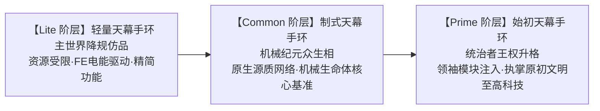
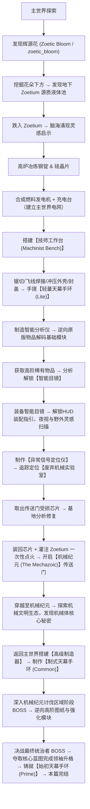
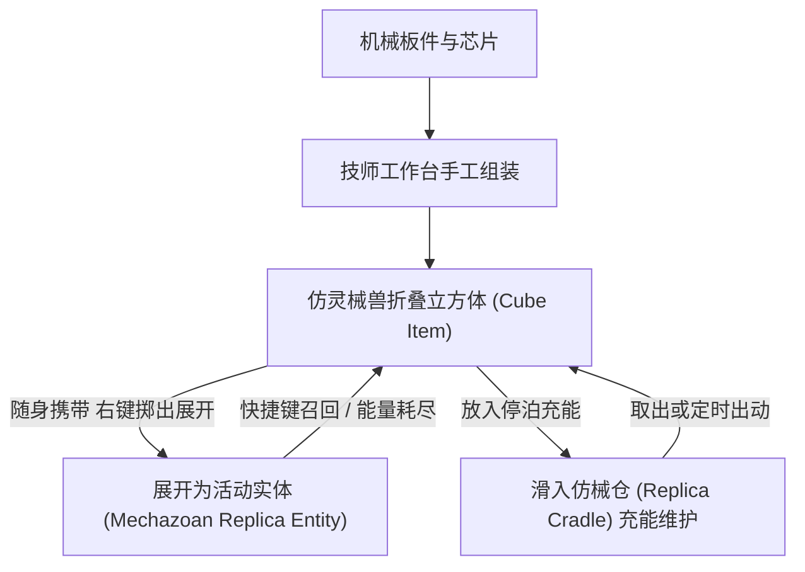

# 🔧 Mechanized 机械纪元 — 总体规划文档

> **模组 ID**: `mechanized` | **版本**: `0.1.0` | **平台**: NeoForge 1.21.1  
> **最后更新**: 2026-10-13  
> **项目愿景**: 以经典冒险模组代表「暮色森林（The Twilight Forest）」为标杆，打造兼具硬核工业沉浸与宏大维度冒险的新一代机械纪元冒险模组。  
> **协作定位说明**: 本文档及本会话**仅用于整体设计思路、世界观规划与核心技术细节讨论**；具体的代码编写与工程实现在独立的代码执行会话中进行。

---

## 📋 目录

1. [当前项目状态](#1-当前项目状态)
2. [整体游戏进程设计](#2-整体游戏进程设计)
3. [系统一：基础材料（钢 & 硅）](#3-系统一基础材料钢--硅)
4. [系统二：能量系统（FE & 源质能量）](#4-系统二能量系统fe--源质能量)
5. [系统三：技师工作台 & 极客装配流程](#5-系统三技师工作台--极客装配流程)
6. [系统四：天幕手环分级框架](#6-系统四天幕手环分级框架)
7. [系统五：模块系统 & 智能目镜](#7-系统五模块系统--智能目镜)
8. [系统六：机器方块与全周期升级体系](#8-系统六机器方块与全周期升级体系)
9. [系统七：自定义液体（源质）](#9-系统七自定义液体源质)
10. [系统八：传送门、遗迹实验室与机械纪元维度](#10-系统八传送门遗迹实验室与机械纪元维度)
11. [系统九：剧情叙事与引导系统](#11-系统九剧情叙事与引导系统)
12. [系统十：机械使魔与自动化坞站技术框架](#12-系统十机械使魔与自动化坞站技术框架)
13. [开发阶段与优先级](#13-开发阶段与优先级)
14. [包结构规划](#14-包结构规划)
15. [待讨论 & 待决事项](#15-待讨论--待决事项)
16. [选做 / 后期优化清单](#16-选做--后期优化清单)

---

## 1. 当前项目状态

### 已实现的内容

| 类型 | 内容 | 状态 |
|------|------|------|
| 物品 | `basic_dome`（初级手环）— GeckoLib 动画物品，Curios 手环槽位 | ✅ 已完成 |
| 物品 | `booster`（推进器）— 装备到靴子槽，加速+跳跃 | ✅ 已完成 |
| 方块 | `zoetic_bloom`（辉源花，原 `energetic_flower`）— FlowerBlock | ✅ 已注册（待增加抽取与枯萎逻辑） |
| 方块 | `harmonizer`（设备调谐台，原 `dome_tuner`）— 带方块实体，有自定义模型 | ✅ 已注册（待重命名与完善功能） |
| 系统 | Curios 集成 — bracelet 槽位、渲染器 | ✅ 已完成 |
| 系统 | GeckoLib 集成 — 手环模型、动画、UV 滚动特效 | ✅ 已完成 |
| 资源 | 中英文本地化、方块状态、模型、贴图 | ✅ 已完成 |

### 尚未实现

- ❌ 配方系统（无任何配方 JSON）
- ❌ 战利品表
- ❌ 能量系统（FE / Zoetium 源质能量）
- ❌ 平衡性配置文件（NeoForge ModConfig：发电机速率、回收率、槽位数等）
- ❌ 自定义实体/生物
- ❌ 自定义液体（Zoetium）
- ❌ 自定义维度（机械纪元）
- ❌ 世界生成（辉源花与地下源质池的自然生成、实验室结构）
- ❌ GUI/菜单系统
- ❌ 网络数据包
- ❌ 音效

---

## 2. 整体游戏进程与世界观叙事

### 🌌 核心命名清单（已确定 ✅）

| 范畴 | 英文/代码标识符 | 本地化名称 | 设计定位与内涵 |
|------|----------------|-----------|----------------|
| **终期维度与文明代号** | `The Mechazoic` | **机械纪元** | 结合 `Mech`（机械）与 `zoic`（地质纪元/生命），完美呼应 Zoetium 源质与失落文明史诗感 |
| **手环核心设备** | `space_dome` | **天幕手环** | 穿戴于手腕的便携式微型能量穹顶核心装置 |
| **初级手环** | `LITE` / `lite_space_dome` | **轻量天幕手环** | 主世界资源受限下的工程降规仿品，外接 FE 电能驱动，槽位精简 |
| **中级手环** | `COMMON` / `common_space_dome` | **制式天幕手环** | 机械纪元本土量产众生相标准规格，每个机械生命体的原生运行基准线 |
| **高级手环** | `PRIME` / `prime_space_dome` | **始初天幕手环** | 击败统治者夺得核心蓝图升格而成的完全体，执掌原初纯正科技的王权象征 |
| **创造级手环** | `CREATIVE` / `creative_space_dome` | **创造天幕手环** | 创造模式专属，无限能量与无限插槽 |
| **手工装配设备** | `machinist_bench` | **技师工作台** | 告别中世纪铁匠打铁感，回归嵌入式创客工程师的工作台实感 |

---

### 📜 核心叙事框架：社会阶层与文明演化阶梯



1. **主世界的降规仿品（Lite 阶层）**：
   * 主世界工程师在资源匮乏、技术断代的环境下，以传统钢材、硅片与铜线在技师工作台上纯手工手搓出的仿造设备；
   * 无法原生承载高维 Zoetium 源质流动，只能退而求其次使用外接 FE 电能驱动，槽位被大幅精简，是典型的工程功能裁切版（Lite）。
2. **机械纪元的众生相（Common 阶层）**：
   * 机械纪元本土量产的大众标准规格。在世界观设定中，**机械纪元的每一个机械生命体，本质上都是由一个类似手环的“核心”再加上各式各样的外装机械模块构建而成**；
   * 代表真正脱离主世界兼容层、原生运行于 Zoetium 源质能源网络下的完全态基准线。
3. **统治者的王权升格（Prime 阶层）**：
   * 玩家在机械纪元直面统治者 BOSS 并将其击败后，夺得核心蓝图，宛如将“领袖模块”注入制式手环中，升格为始初完全体；
   * 标志着玩家从主世界的“逆向仿制者”、机械维度的“外来过客”，彻底升格为执掌机械文明原初纯正科技的最终统治者！

---

### 💡 创作者思路与意象脉络纪实

1. **“振金（Vibranium）”的现代化造词哲学**：
   * 抛弃传统玄幻模组中文绉绉的生僻字，回归“物理特质 + 基础材料/工业后缀”的干脆利落。促成了英文保留独特自研的 `Zoetium`（生命能量液体），中文直接定下厚重干脆的“源质”。
2. **特摄玩具与钢普拉的“分件与降规”艺术**：
   * 对标万代特摄的食玩/扭蛋对比 DX 规格，以及钢普拉（EG/HG 对比 MG/PG）的工程分级。明确初级手环不是残次品，而是“为了在低成本/受限环境下跑通逻辑而特意做出的工程取舍与功能阉割”，从而精准锁定了 `Lite`。
3. **《变形金刚》的领袖升格与阶层演进**：
   * 借用了平民机械体奥利安·派克斯（Orion Pax）融入领袖模块升格为擎天柱（Optimus Prime）的史诗叙事。让 `Common` 与 `Prime` 形成绝妙对仗，将数值装备迭代升华为了从“市井平民制式”到“领袖始源神物”的文明跃迁。
4. **创客与硬件工程师的工位实感**：
   * 摒弃传统魔幻铁匠铺的叮当打铁味，精准锚定嵌入式极客在私人工作台前切板材、焊飞线、装外壳、调固件的真实日常，最终定名为“技师工作台（Machinist Bench）”。

---

### 🗺️ 主线推进流程



---

## 3. 系统一：基础材料（钢 & 硅）

### 设计方案（已确定 ✅）

#### 钢锭（Steel Ingot）
```
工作台合成：铁锭 + 煤炭 → 粗钢坯（Raw Steel Blend）
高炉冶炼：粗钢坯 → 钢锭（Steel Ingot）
```

#### 硅晶片（Silicon Wafer）
```
高炉冶炼：下界石英 → 硅晶片（Silicon Wafer）
```

#### 衍生建材与工匠锻造台合成（已确定 ✅）
* **钢块（Steel Block）**：9 个钢锭合成。
* **钢板（Steel Plate）**：工作台 2 个钢锭横向排列合成。
* **钢棒（Steel Rod）**：工作台 2 个钢锭竖向排列合成。
* **技师工作台（Machinist Bench）**：
  * **借鉴原版铁砧合成摆法**：顶部一排 3 个钢块，中间 1 个钢锭，底部一排 3 个钢锭。极具工业重工质感，贴近原版记忆，告别传统铁匠铺，化身创客工作台。

#### 辉源花（Zoetic Bloom）生态与能量抽取机制（已确定 ✅）
* **官方注册 ID**：`zoetic_bloom`（原暂定名 `energetic_flower`）。
* **生态共生**：主世界地表自然生成的辉源花，是地下深处 Zoetium 源质能量向上渗透并与植物生命力深度融合的产物。
* **能量提取与枯萎**：
  * 玩家采摘辉源花后，可放入机器中提取纯净的 Zoetium 能量。
  * **抽取后变化**：提取完成后花朵退化为**【枯萎灌木 / 枯木】**。
  * **世界观解释**：Zoetium 源质与植物本身的生命本源已彻底交织，当能量被强行剥离时，植物原本的生命力也会随之流失耗尽。

---

## 4. 系统二：能量系统（FE & Zoetium 源质能量）

### 双层能量体系（已确定 ✅）

| 能量类型 | 适用对象 | 来源 | 说明 |
|----------|----------|------|------|
| **电能（FE）** | 轻量手环（Lite）、早期工具（焊枪等）、早期机器 | 燃料发电机、风能/太阳能、其他科技模组 | 主世界科技标准（兼容第三方模组线缆） |
| **源质能量（Zoetium）** | 制式/始初手环（Common/Prime）、后期机器 | Zoetium 液体直接灌注、辉源花抽取、源质虹吸模块 | 机械纪元正统科技 |

### 独立平衡性配置系统（NeoForge ModConfig ✅）
为了保证整合包友好与玩家自定义自由度，避免数值平衡争议，以下所有关键数值均**禁止硬编码**，统一提取至 `config/mechanized-server.toml`：
* `generator_burn_rate`：发电机燃烧与发电速率；
* `charging_station_rate`：充电台输入与输出速率；
* `recycling_success_rate`：废品回收炉的基础回收成功率；
* `dome_slot_counts`：各等级手环默认模块槽位上限（Lite 3 / Common 5 / Prime 9）；
* `welding_torch_energy_capacity` / `cost_per_weld`：焊枪电量上限与单次焊接能耗。

### 供电与电网机制
1. **前期（主世界）**：
   * **发电机内置充能槽**：可直接将焊枪、轻量手环放入随身充能。
   * **邻接自动推电**：发电机紧贴充电台等机器时自动平缓供电，无需拉线。
   * **兼容第三方线缆**：全面暴露 NeoForge `IEnergyStorage` Capability。
2. **后期（机械纪元突破）**：
   * **无线共鸣能量塔（Wireless Power Pylon）**：摆脱传统拉电线模式，区域内无线广播供能。

---

## 5. 系统三：技师工作台 & 极客装配流程

### 核心交互机制（已确定 ✅）
* **无 GUI，纯世界右键交互**：创客工程师在工作台切基板、焊引脚、冲压外壳、组装封盖，物品如同营火一样立体渲染在工作台表面。
* **操作方式**：
  * 放置：主手持材料右键台面。
  * 冲压锤击：手持锤子右键，**单次敲打，内置 0.5 秒冷却**（防误触，节奏感强）。
  * 点焊飞线：主手焊枪长按右键，**松开暂停可继续累积进度**。
  * 修边切割：手持锯子单次右键修边。
* **视觉与音效**：
  * 锤打：金属叮叮声 + 溅射火星；
  * 焊接：电弧滋滋声 + 焊接粒子；
  * 切割：切割飞屑粒子 + 电锯音效。

### 轻量天幕手环 (Lite) 装配 4 步工序（方式 A 已确定 ✅）
1. `放置` 硅晶片 ➔ `锯子切割`（修整芯片引脚）；
2. `放置` 铜线/红石 ➔ `焊枪焊接` 3秒（焊接控制回路与引脚飞线）；
3. `放置` 钢板 ➔ `锤打` 3次（冲压成手镯外壳，与底板契合）；
4. `放置` 玻璃板 ➔ `焊枪焊接` 2秒（密封封装全息显示屏，产出【轻量天幕手环】）。

### 容错与废品回收系统
* 任何一步顺序错误、使用错误工具即判定为报废，生成【金属废品】。
* 废品保存内部原料数据，放入【回收炉】可按配置文件中设定的成功率（`recycling_success_rate`）回收原材料。

---

## 6. 系统四：天幕手环分级框架

### 通用框架类与枚举（已确定 ✅）
* `SpaceDomeItem` 通用类继承自 `Item` 并实现 GeckoLib `GeoItem` 与 Curios 接口。
* `DomeTier` 枚举定义：
  * `LITE`：默认 3 槽位（Config 可配），FE 电能，1000 容量（轻量天幕手环）
  * `COMMON`：默认 5 槽位（Config 可配），Zoetium 源质能量，5000 容量（制式天幕手环）
  * `PRIME`：默认 9 槽位（Config 可配），Zoetium 源质能量，20000 容量（始初天幕手环）
  * `CREATIVE`：无限槽位，无限能量（创造天幕手环）
* 所有参数统一在枚举与配置文件中对外暴露，方便玩家与整合包作者随时平衡调试。

### 核心前置依赖原则（已确定 ✅）
* **Curios API & GeckoLib 设为强制必装（Required Dependency）**：
  * **零分支冗余**：避免因选装引入双套手环模型、双套槽位逻辑与大量 `isModLoaded` 条件分支，极大保障代码稳定性与执行效率；
  * **生态标准契合**：两大库在 1.21.1 科技/冒险整合包中均为行业通用标准，强绑定不会对玩家产生额外心智负担，利于聚焦动画品质与沉浸式佩戴。

### Zoetium 充能体系（已确定 ✅）
* **基地充能**：设备调谐台（The Harmonizer，ID `harmonizer`）接入流体储罐，放入手环快速注入 Zoetium。
* **野外充能（源质虹吸模块）**：搭载该模块后，玩家佩戴手环浸入 Zoetium 池，手环会缓慢虹吸能量被动回能。

---

## 7. 系统五：模块系统 & 智能目镜

### 环形模块选择轮盘（Radial Menu · 已确定 ✅）
* **参考标杆**：对标 **Create（机械动力）的 `RadialMenu`**（工具箱轮盘）与 **Iron's Spells** 技能环。
* **交互体验**：
  * 长按专属快捷键（默认 `V` 键）呼出，屏幕中央展开圆形辐射式轮盘；
  * 根据鼠标位移相对圆心的角度（`Math.atan2`）动态高亮对应扇形区块；
  * 各扇区展示已搭载模块图标、工作状态、充能比例与冷却状态；
  * 松开快捷键完成模式切换或主动激活，纯 OpenGL/GuiGraphics 原生绘制，轻量零冗余。

### 纳米消融/凝聚装配渲染器（Nano Dissolve Renderer Architecture Spec · 已确定 ✅）
对标钢铁侠 MK85 纳米装甲消融/向前像素延伸显现与消失效果，为所有静态扩展模块赋予统一的顶级动效：
* **零动画依赖（Asset-Efficient）**：
  * 模块只需接收静态 3D 几何模型（Blockbench 导出 JSON/OBJ），无需绑骨骼调复杂拼装关键帧动画；
* **局部模型空间裁剪（Local Space Y）**：
  * 顶点着色器将模型的局部 Y 轴坐标传递至片段着色器；
  * 片段着色器判断 `v_LocalPos.y + noiseValue * scale < Progress`，确保无论模型 UV 怎么展开，动效始终沿着手臂骨骼物理方向从手腕平滑推进至手尖；
* **四阶手环视觉参数解耦（`BraceletVisualConfig`）**：
  * `Lite`（轻量仿造）：`20 ticks` 较慢装配，`#FF9900` 工业橙黄电弧火花，粗颗粒噪波；
  * `Common`（制式原生）：`8 ticks` 疾速装配，`#06D5F9` 源质青蓝冷光，细腻纳米流光；
  * `Prime`（始初领袖）：`4 ticks` 瞬息重组，`#E056FD` 矩阵紫金流光，蜂巢晶格噪波；
* **通用光影多环境自适应（Iris/Oculus & Vanilla Dual-Path）**：
  * **未开启光影**：走原生 Core Shader（双采样器 + 局部 Y 空间 discard 剔除 + 边缘像素加亮）；
  * **开启任意光影（BSL / Complementary 等）**：走通用双 Pass 管线（Pass 1 采用实体 Alpha Cutoff 原生裁切；Pass 2 采用 `RenderType.eyes` / `energySwirl` 通道强行触发光影环境下的全屏 Neon Bloom 发光能量带）。

### 前后端双轨协作闭环（已确定 ✅）
* **智能目镜（前端/外出侦测）**：
  * 装备于 Curios 专属 `goggles` 槽位，不占头盔位。
  * 外出探索时，目镜自动高亮标记世界中具有“潜在灵感”的特殊物体，或生成扫描数据卡。
  * 带有**夜视模式**（右键切换），主手持焊枪时触发展开全面罩动画。
  * 显示锻造台序列装配 HUD，彻底避免操作失误。
* **智能分析仪（后方/基地逆向解码）**：
  * 将采集回来的灵感物品或目镜数据放入分析仪解码，生成【模块图纸】。
  * 早期基础模块逆向表：
    * `铁镐` ➔ **⛏️ 挖掘模块（Mining Module）**
    * `羽毛/烟花` ➔ **🚀 推进模块（Booster Module）**
    * `指南针/铁块` ➔ **🧲 磁吸模块（Magnet Module）**
    * `盾牌/绿宝石` ➔ **🛡️ 动能护盾模块（Kinetic Shield Module）**
  * **科技树质变点**：探索获取高阶稀有物品（如下界之星）➔ 放入分析仪逆向解锁【智能目镜图纸】！

---

## 8. 系统六：机器方块与全周期升级体系

### 机器“永不落伍”设计哲学（已确定 ✅）
* 机器不仅在前期使用，全程伴随玩家成长：
  * **智能分析仪**：中期分析机械纪元外星科技，后期分析 BOSS 战利品传奇图纸；后期部分高阶物体需前置解密后才能送入分析仪。
  * **工匠锻造台**：后期使用机械纪元新金属进行高阶精密锻造。
  * **全系机器模块化升级**：各机器预留升级槽位，支持安装【加速模块】、【能效模块】、【储量扩展模块】等。

---

## 9. 系统七：自定义液体（Zoetium 源质）

### 视觉与物理属性（已确定 ✅）
* **官方正式定名**：英文 `Zoetium`（意为“充满生命与生机的能量之液”），中文“源质”。
* **外观颜色**：发光的半透明青蓝色（十六进制：`#06D5F9`，ARGB 约 `0xCC06D5F9`）。
* **光照强度**：轻微自发光（Light Level 8~10）。
* **粒子效果**：复用原版微光/传送门粒子进行青蓝色改色，和谐融入原版画风。
* **特殊机制**：玩家跌入未加工 Zoetium 液体时触发剧情叙事字幕与灵感涌现。

---

## 10. 系统八：传送门、遗迹实验室与机械纪元维度

### 废弃机械实验室与激活流程（已确定 ✅）
* **生成结构**：主世界自然生成稀有地下/地表遗迹【废弃机械实验室（Abandoned Lab）】。
* **寻找机制（告别原版眼盲痛点）**：
  * 制作**【异常信号定位仪（Signal Locator）】**。
  * 不会像末影之眼那样消耗碎裂，手持或右键提供明确的信号指示（音调频率或 HUD 方位引导），指引玩家直奔实验室。
* **修复与启动**：
  1. 取下控制台损坏的芯片 ➔ 带回基地用分析仪修复；
  2. 将修复芯片插回传送门控制台；
  3. 注入适量源质液体完成“一次性点火”；
  4. 传送门常态开启，永久免维护运行！

---

## 11. 系统九：剧情叙事与引导系统

### 沉浸式环境叙事（已确定 ✅）
* **关键剧情节点**（如跌入源质、激活传送门）：采用**屏幕大标题文字（Title）+ 聊天栏日志 + 专属环境音效**呈现。
* **主线引导机制**：采用**原版 Advancements（成就进度树）**，直观清晰指引玩家下一阶段目标。
* **说明书生态**：后续可选接入 Patchouli 模组作为拓展手册，不作为强制前置。

---

## 12. 系统十：机生种生态、仿灵械兽与仿械仓技术框架 (Mechazoa System)

### 世界观与进化哲学：硅基自然演化闭环（已确定 ✅）
* **物种演化与命名体系闭环**：
  * **宏大纪元**：**`The Mechazoic`（机械纪元）**（类比古生代/中生代，代表独特的失落时空纪元）；
  * **生物门类总称**：**`Mechazoa`（机生种）**（类比 Metazoa 后生动物门，代表整个异星生命演化枝）；
  * **原生灵械兽**：**`Mechazoan`（灵械兽）**（远古繁衍至今、完全由机械架构与源质驱动的自然生命）；
  * **玩家复刻仆从**：**`Mechazoan Replica`（仿灵械兽）**（玩家逆向工程研究后，在技师工作台上用板件与芯片手搓出来的复刻版机械助手）。
* **生命演化哲思（碳基 vs 硅基）**：
  * 机生种绝非冰冷的人造机器人，而是自然演化的硅基生命。
  * 犹如地球碳基生物自然生长骨骼、甲壳与指甲一样，机生种在富含金属矿物与高密度 Zoetium 源质的环境中，自然演化出高强度金属外骨骼、铰链关节与硅基晶体感官；
  * 初访机械纪元的玩家虽因视觉反差深感震撼，但其本质是异星生命探索未知自然法则的壮丽进化成果。

### 仿灵械兽变形折叠与仿械仓（Replica Cradle · 已确定 ✅）
* **变形金刚式立方体收纳（Transformer Cube Folding）**：
  * 仿灵械兽平时作为活动实体协助作战、采集或自动化运输；
  * 当其**能量耗尽**或**被玩家主动召回**时，通过机械铰链与模块化滑动构件，**如变形金刚般精密折叠闭锁成一个标准的 1x1 方块立方体道具（Cube Form）**，方便随身携带或归巢。
* **仿械仓（Replica Cradle Block · 方块 ID: `replica_cradle`）**：
  * 布置在基地的停泊底座与维护中心；
  * 折叠成方块形态的仿灵械兽滑入仿械仓后进入休眠，仓体为其高速注入 FE 或 Zoetium 源质能量，并自动完成构件修复；
  * 平时未激活时也可作为陈列展示与维护收纳单元。

### 实体与作业双模驱动架构



1. **随身随行模式（Field Companion）**：
   * 实体基类 `MechazoanReplicaEntity`（继承自 `TamableAnimal` 并集成能量组件）；
   * 提供辅助作战、自动拾取、局部动态照明、生物/矿物脉冲探测等机能；
   * 随身携带，支持快速变形展开与折叠召回。
2. **基地自动化作业模式（Base Automation）**：
   * 仿械仓为仿灵械兽划定工作半径（8~16格）；
   * 灵械仆从在坞站与各机器间执行轻量级自动化任务（搬运物料、运送废品至回收炉、递送充能电池等）。

### 独立开发者的“降本增效”美术工程学（Asset-Efficient）
* **低多边形板件建模合法性**：仿灵械兽由平整的机械板件拼装并具立方体折叠形态，在 Blockbench 中制作极快且兼具硬核机械美学；
* **通用骨骼动画高度复用**：维护 **四足兽型骨骼** 与 **双翼飞禽型骨骼** 2 套基准骨骼，替换板件造型即可高产派生出丰富品类；
* **程序化着色器接管视觉**：利用源质粒子与纳米消融着色器接管变形与召唤特效。

### 服务端平衡配置（NeoForge ModConfig ✅）
统一提取至 `config/mechanized-server.toml`：
* `max_replicas_per_player`：单玩家最大可同时激活的仿灵械兽上限（默认 1~2 只）；
* `replica_cradle_work_radius`：仿械仓作业范围半径；
* `replica_energy_capacity`：仿灵械兽基础电池容量。

---

## 13. 开发阶段与版本发布策略 (Release Roadmap)

### 版本发布策略（已确定 ✅）

| 版本阶段 | 对应开发阶段 | 发布平台 | 核心内容与宣发卖点 |
|----------|--------------|----------|-------------------|
| **v0.1.0-alpha** | **Phase 1 完成** | CurseForge / Modrinth | **核心闭环验证**：粗钢/硅材料链 + 发电充电 + 铁砧式技师工作台（纯世界右键序列装配，极客创客手搓玩法）+ GeckoLib 动画轻量天幕手环 + JEI/EMI 完整配方联动。配合短视频/GIF 快速打响知名度！ |
| **v0.2.0-beta** | **Phase 2 完成** | 同上 | **实用性飞跃**：智能分析仪（逆向原版物品）+ 智能目镜 HUD + 首批实用模块 + 环形轮盘（Radial Menu）+ 废品回收炉。具备完整生存实战价值。 |
| **v1.0.0 正式版** | **Phase 3 & 4 完成** | 全平台正式发布 | **宏大维度冒险**：Zoetium 源质世界生成 + 废弃机械实验室遗迹 + 机械纪元（The Mechazoic）新维度生态 + 机械使魔系统 + 阶段 BOSS 与统治者主线终局。 |

---

### Phase 1：基础材料 & 能量 & 核心制造 🔴 最高优先 (Alpha 发布目标)

> 目标：玩家能够从零开始——炼钢炼硅 → 发电充电 → 技师工作台极客装配 → 手搓出【轻量天幕手环 (Lite)】

- [ ] 注册基础材料物品（粗钢坯、钢锭、钢块、钢板、钢棒、硅晶片）
- [ ] 编写原版配方 JSON（粗钢坯合成、高炉炼钢、高炉炼硅、钢块/板/棒合成）
- [ ] 编写技师工作台合成配方（铁砧式摆法）
- [ ] 实现能量系统基础（NeoForge IEnergyStorage Capability、DataComponents 物品储能）
- [ ] 实现燃料发电机方块 + BE + 内置充能槽与邻接推电 + GUI
- [ ] 实现充电台方块 + BE + GUI
- [ ] 注册工具物品（锤子-带冷却、焊枪-电动长按、锯子）
- [ ] 注册焊接面具物品（副手持有）
- [ ] 重构手环基类为通用 `SpaceDomeItem` + `DomeTier` 枚举（LITE / COMMON / PRIME / CREATIVE）
- [ ] 注册 4 个等级的天幕手环物品（`lite_space_dome`, `common_space_dome`, `prime_space_dome`, `creative_space_dome`）
- [ ] 实现技师工作台方块 + 方块实体 + 营火式立体零件渲染（`MachinistBenchBlock`, `MachinistBenchBlockEntity`, `MachinistBenchRenderer`）
- [ ] 实现自定义装配配方类型 `AssemblyRecipe` + 序列化器（4步工序）
- [ ] 实现技师工作台交互逻辑、粒子与音效反馈
- [ ] 实现金属废品与可配置回收率接口 `RecyclingConfig`
- [ ] 编写轻量天幕手环完整的技师装配配方 JSON

### Phase 2：模块 & 机器 & 目镜系统 🟡 高优先 (Beta 发布目标)

> 目标：智能分析仪逆向图纸、设备调谐台装载、纳米消融装配渲染器、智能目镜解锁与 HUD、环形轮盘

- [ ] 实现智能分析仪方块 + BE + GUI（原版物品逆向解码）
- [ ] 实现设备调谐台（The Harmonizer，原 Dome Tuner）方块 + BE + GUI — 模块装卸与源质流体储罐
- [ ] 实现第一批核心模块：⛏️挖掘、🚀推进、🧲磁吸、🛡️护盾、💧源质虹吸
- [ ] 实现纳米消融/凝聚装配渲染器（Nano Dissolve Renderer：Local Y 空间裁切 + 双轨光影兼容 + 阶梯配置）
- [ ] 注册智能目镜物品 + Curios `goggles` 槽位
- [ ] 实现焊接保护判定（面具/目镜防失明伤害）
- [ ] 实现智能目镜 HUD（装配引导、野外灵感扫描高亮、夜视切换）
- [ ] 实现环形技能/模块选择轮盘（Radial Menu）
- [ ] 实现回收炉方块 + GUI
- [ ] 🎮 JEI & EMI 配方集成（必做）：技师工作台装配配方、智能分析仪逆向配方与回收配方查看支持

### Phase 3：世界生成 & 液体 & 实验室探索 🟢 中优先

> 目标：Zoetium 源质自然生成、异常信号定位仪、实验室传送门激活

- [ ] 注册青蓝色源质液体（#06D5F9）+ 流体方块 + 桶 + 改色粒子
- [ ] 实现地表辉源花（`zoetic_bloom`）与地下源质池世界生成
- [ ] 实现跌入源质时的屏幕文字叙事与灵感 Advancements
- [ ] 实现废弃机械实验室（Abandoned Lab）结构生成
- [ ] 实现异常信号定位仪（Signal Locator）及寻路逻辑
- [ ] 实现传送门修复芯片与点火开启逻辑

### Phase 4：维度 & 机生种生态 & 机械纪元终局 🔵 后期

> 目标：进入机械纪元（The Mechazoic），原生机生种（Mechazoa）与灵械兽（Mechazoan），仿灵械兽（Mechazoan Replica）折叠立方体与仿械仓（Replica Cradle），多方块高级制造器，无线电网，制式与始初手环，领袖升格

- [ ] 设计并实现机械纪元维度（群系、地表、噪声地形、失落文明废墟）
- [ ] 机械纪元原生机生种（Mechazoa）生态、硅基植被与金属矿物
- [ ] 实现仿灵械兽系统（板件切削、手工组装、四足/飞禽通用动画实体、变形金刚式立方体折叠收纳）
- [ ] 实现仿械仓方块（Replica Cradle Block + BE，自动化停泊、充能、维修与轻量物料调度）
- [ ] 实现高级制造器（多方块结构）
- [ ] 制作制式天幕手环（Common）
- [ ] 实现无线共鸣能量塔
- [ ] 机械纪元阶段 BOSS 与统治者挑战（夺取核心蓝图完成领袖模块升格，铸就始初天幕手环 Prime）

---

## 14. 包结构规划

```
com.ronicus.mechanized/
├── Mechanized.java                     ← 模组主入口
│
├── core/                               ← 【核心基础设施层】（参考 AE2 / Create 基础层）
│   ├── registry/                       ← 统一注册中心（Blocks, Items, BlockEntities, Menus, Recipes 等）
│   ├── config/                         ← NeoForge ModConfig 配置中心（MechanizedConfig，管理平衡性参数）
│   └── network/                        ← 统一网络数据包系统（Payloads, S2C/C2S 同步）
│
├── api/                                ← 【接口层】（参考 Botania / Ars Nouveau 标准）
│   ├── module/                         ← 模块标准化契约（IModule, ModuleCategory, ModuleContext）
│   ├── familiar/                       ← 使魔行动与作业能力契约（IFamiliar, IFamiliarTask）
│   └── energy/                         ← 能量接口契约（IEnergyStorage 扩展、Zoetium 源质能量接口）
│
├── content/                            ← 【业务内容层】按子系统/玩法垂直切片（参考 Create / AE2）
│   │
│   ├── material/                       ← 基础原材料（钢材、硅晶片、粗坯等纯物品）
│   │
│   ├── device/                         ← 核心穿戴与便携设备（参考 Ars Nouveau）
│   │   ├── dome/                       ← 天幕手环系统（SpaceDomeItem, DomeTier, Curios 渲染与状态）
│   │   ├── goggles/                    ← 智能目镜（SmartGogglesItem, 护眼判定, 专属渲染）
│   │   └── locator/                    ← 异常信号定位仪（SignalLocatorItem, 结构感知与定位算法）
│   │
│   ├── module/                         ← 手环功能模块具体实现（高内聚自闭环）
│   │   ├── booster/                    ← 推进机动模块（整合原靴子推进器）
│   │   ├── mining/                     ← 辅助挖掘模块
│   │   ├── magnet/                     ← 磁吸拾取模块
│   │   ├── shield/                     ← 动能护盾模块
│   │   └── siphon/                     ← Zoetium 源质虹吸模块
│   │
│   ├── familiar/                       ← 【机械使魔子系统】（板件道具, 实体基类, 坞站方块, 极简板件渲染）
│   │   ├── item/                       ← 机械板件道具 (RunnerKitItem, FamiliarCapsuleItem)
│   │   ├── entity/                     ← 使魔实体基类与行为 (MechanicalFamiliarEntity, AI goals)
│   │   ├── block/                      ← 使魔作业坞方块与实体 (FamiliarDockBlock, BE)
│   │   └── client/                     ← 板件折叠与低多边形渲染 (GeoModel, LayerRenderer)
│   │
│   ├── tool/                           ← 工匠手工工具（铁砧式锻造锤、充电式电焊枪、切割锯、防护面具）
│   │
│   └── machine/                        ← 机器方块（各机器自闭环聚合 Block + BE + Menu + Screen）
│       ├── bench/                      ← 技师工作台（MachinistBenchBlock, BE, 营火式零件渲染, 纯世界交互）
│       ├── generator/                  ← 燃料发电机（GeneratorBlock, BE, Menu, Screen, 内置充能槽与邻接推电）
│       ├── charging/                   ← 充电台
│       ├── analyzer/                   ← 智能分析仪（逆向解码原版物品与目镜数据）
│       ├── tuner/                      ← 手环调整器（模块装卸与流体储罐）
│       └── recycler/                   ← 金属废品回收炉
│
├── recipe/                             ← 【配方系统】自定义数据驱动配方
│   ├── assembly/                       ← 技师工作台序列装配配方（AssemblyRecipe, AssemblyRecipeSerializer）
│   └── analyzer/                       ← 逆向分析配方（AnalyzerRecipe, AnalyzerRecipeSerializer）
│
├── world/                              ← 【世界与探险层】（参考 暮色森林 The Twilight Forest）
│   ├── fluid/                          ← Zoetium 源质液体（FluidType, FlowingFluid, LiquidBlock）
│   ├── feature/                        ← 地表辉源花与地下源质池自然生成
│   ├── structure/                      ← 废弃机械实验室（Abandoned Lab 遗迹结构）
│   ├── dimension/                      ← 【Phase 4】机械纪元维度（The Mechazoic）、生物群系与噪声地形
│   └── progression/                    ← 【Phase 4】阶段限制、结界与主线进度锁
│
├── client/                             ← 【客户端专属层】纯视觉呈现
│   ├── hud/                            ← 智能目镜 HUD、装配步骤指引 HUD、定位仪方位指引
│   ├── overlay/                        ← 焊接强光白屏/失明屏幕遮罩
│   └── particle/                       ← Zoetium 青蓝微光粒子、焊接火花电弧粒子
│
└── compat/                             ← 【生态兼容层】外部模组联动
    ├── jei/                            ← JEI 工作台装配与分析配方查看集成
    ├── emi/                            ← EMI 配方查看集成
    └── curios/                         ← Curios 专属槽位驱动与数据包定义
```

---

## 15. 选做 / 后期优化清单

- [ ] 🔨 技师工作台零件随操作步骤变形（锤打后变扁、切割后分裂等）
- [ ] 🎨 智能目镜全面罩展开动画（主手拿焊枪时触发）
- [ ] 🌬️ 风力发电机、太阳能发电板等额外发电设备
- [ ] 🔊 专属音效设计包（机器运行、电流共鸣等）
- [ ] 📖 Patchouli 官方指导手册联动支持

