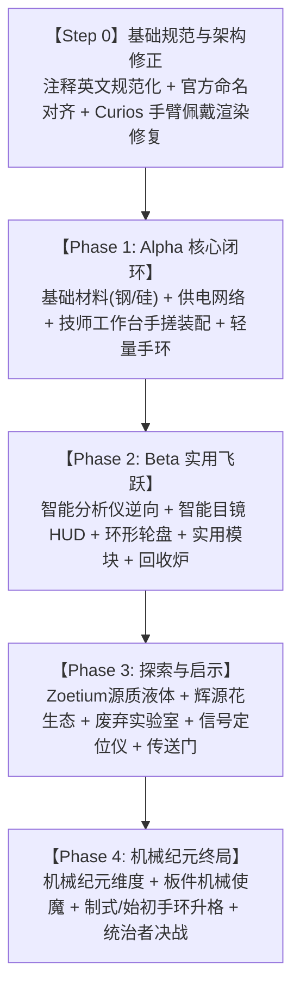

# 📋 Mechanized 架构对齐与总体开发实施方案 (Implementation Plan)

## 🎯 目标概述 (Goal Description)

依据 [`docs/mechanized_development_plan.md`](file:///d:/Entertainment/MC/ModDevelopment/Mine/Mechanized-1.21.1-neoforge/docs/mechanized_development_plan.md) 的总体设计，建立覆盖 **全生命周期的任务清单与实施路线图**。
特别针对用户提出的两项前置修正诉求以及 Curios 佩戴渲染问题，将它们作为 **「Step 0：基础规范与命名对齐」** 优先嵌入到开发清单最前沿，形成自洽且平滑的推进闭环：
1. **代码注释全量英文规范化**（Javadocs & inline comments 全部替换为规范英文）；
2. **文档敲定命名对齐**（`energetic_flower` $\to$ `zoetic_bloom` 辉源花；`basic_dome` $\to$ `lite_space_dome` 轻量天幕手环，同步更新模型/贴图/动画/语言文件）；
3. **Curios 佩戴手环渲染修复**（解决手环佩戴在手臂上时的定位、朝向、尺寸及动画同步）；
4. **后续核心玩法阶段性递进**（Phase 1 基础工业与手搓装配 $\to$ Phase 2 模块与目镜 $\to$ Phase 3 遗迹与源质 $\to$ Phase 4 维度与使魔）。

---

## 👥 用户审核事项 (User Review Required)

> [!IMPORTANT]
> **资源重命名涉及的兼容性**：
> 将 `basic_dome` 重命名为 `lite_space_dome`、`energetic_flower` 重命名为 `zoetic_bloom` 会导致现有测试存档中已存在的旧方块/物品 ID 变更（属于开发早期正常的重构更名）。由于目前处于纯开发期，这是对齐规划文档的黄金时机。

> [!NOTE]
> **文件结构与类名对齐**：
> - `BasicDomeItem.java` $\to$ `LiteSpaceDomeItem.java`（或提供通用基类 `SpaceDomeItem`）
> - `BasicDomeItemModel.java` $\to$ `LiteSpaceDomeItemModel.java`
> - `BasicDomeItemRenderer.java` $\to$ `LiteSpaceDomeItemRenderer.java`
> - `BasicDomeCurioRenderer.java` $\to$ `LiteSpaceDomeCurioRenderer.java`
> - 资源文件同步重命名为 `lite_space_dome.geo.json`、`lite_space_dome.animation.json`、`lite_space_dome.png`

---

## 🗺️ 全局开发清单与阶段映射 (Roadmap & Checklist)

### 🔴 Step 0：基础规范、命名对齐与佩戴渲染（当前立即执行任务）

- [ ] **Task 0.1：代码注释规范化 (English Comments Standard)**
  - 将所有 Java 类中的中文注释替换为规范地道的英文 Javadoc 与代码内联说明。
- [ ] **Task 0.2：官方命名与本地化对齐 (Registry & Localization Alignment)**
  - **辉源花**：`energetic_flower` $\to$ `zoetic_bloom`（英文: `Zoetic Bloom`，中文: `辉源花`）。
  - **轻量手环**：`basic_dome` $\to$ `lite_space_dome`（英文: `Lite Space Dome`，中文: `轻量天幕手环`）。
  - 同步重命名资源：`textures/`, `models/`, `blockstates/`, `geo/`, `animations/`, `curios/tags/`。
- [ ] **Task 0.3：Curios 佩戴手环渲染修复 (Curios Wrist Rendering Fix)**
  - 检查并修复 `BasicDomeCurioRenderer` 在玩家手臂上的矩阵变换（原点、旋转角、比例）；
  - 接入动态姿态与 GeckoLib 动画同步，确保佩戴在手上时同样保持手环折叠/展开与 UV 滚动。

---

### 🔴 Phase 1：基础材料 & 能量 & 核心制造 (v0.1.0-alpha)

> 目标：玩家能够从零开始——炼钢炼硅 $\to$ 发电充电 $\to$ 技师工作台极客装配 $\to$ 手搓出【轻量天幕手环 (Lite)】

- [ ] **材料与配方链**
  - 注册粗钢坯 (`raw_steel_blend`)、钢锭 (`steel_ingot`)、钢块 (`steel_block`)、钢板 (`steel_plate`)、钢棒 (`steel_rod`)、硅晶片 (`silicon_wafer`)；
  - 编写高炉炼钢（铁+煤$\to$粗钢坯$\to$钢锭）、高炉炼硅（下界石英$\to$硅晶片）配方 JSON；
- [ ] **供电网络体系**
  - 实现 NeoForge `IEnergyStorage` 统一对接与物品 DataComponent 储能；
  - 实现燃料发电机 (`GeneratorBlock` + BE + GUI + 邻接推电 + 内置充能槽)；
  - 实现充电台 (`ChargingStationBlock` + BE + GUI)；
- [ ] **工具系统**
  - 注册工匠锻造锤（带 0.5s 防误触冷却）、充电式电焊枪（长按累积进度）、切割锯；
- [ ] **技师工作台 (Machinist Bench)**
  - 注册铁砧摆法合成；
  - 实现纯世界右键交互逻辑、营火式立体零件渲染、粒子与音效（敲打火星、焊接电弧、切割飞屑）；
  - 实现自定义装配配方类型 `AssemblyRecipe`（4 步工序）与废品回收逻辑；
- [ ] **手环体系与通用类**
  - 提取通用 `SpaceDomeItem` 基类与 `DomeTier` 枚举；
  - 完成轻量天幕手环手搓配方。

---

### 🟡 Phase 2：模块系统、机器与智能目镜 (v0.2.0-beta)

> 目标：智能分析仪逆向图纸、手环调整器装载、智能目镜解锁与 HUD、环形轮盘

- [ ] **智能分析仪 (Smart Analyzer)**
  - 原版物品逆向解码机制（铁镐$\to$挖掘模块，羽毛/烟花$\to$推进模块等）；
- [ ] **手环调整器 (Dome Tuner)**
  - 完善调整器 GUI（模块插拔、充能注能）；
- [ ] **核心模块群**
  - ⛏️ 辅助挖掘模块、🚀 推进机动模块（重构整合原鞋子推进器）、🧲 磁吸模块、🛡️ 动能护盾模块、💧 源质虹吸模块；
- [ ] **智能目镜 (Smart Goggles)**
  - Curios `goggles` 槽位，夜视模式切换，主手持焊枪时展开全面罩动画；
  - 智能目镜 HUD（装配引导、野外灵感扫描高亮）；
- [ ] **环形交互轮盘 (Radial Menu)**
  - 对标 Create 的 `RadialMenu`，按 `V` 键展开扇形轮盘选择与切换模块；
- [ ] **JEI & EMI 配方集成**。

---

### 🟢 Phase 3：世界生成、液体与废弃实验室探索

> 目标：Zoetium 源质自然生成、异常信号定位仪、废弃实验室与传送门点火

- [ ] **Zoetium 源质流体**
  - 青蓝色半透明流体（`#06D5F9`）+ 改色粒子，跌入时触发剧情大标题与灵感字幕；
  - 地表辉源花与地下源质池自然生成；
  - 辉源花抽取能量后退化为枯木的机制；
- [ ] **废弃机械实验室 (Abandoned Lab)**
  - 主世界遗迹结构生成；
  - 制作【异常信号定位仪 (Signal Locator)】，手持音频/方位指引寻路；
  - 传送门修复芯片提取、分析仪修复、插回控制台 + 源质一次性点火。

---

### 🔵 Phase 4：机械纪元维度与板件使魔 (v1.0.0 正式版)

> 目标：机械纪元生态、机械板件使魔与自动化作业坞、统治者 BOSS 决战与领袖升格

- [ ] **机械纪元维度 (The Mechazoic)**
  - 专属维度群系、失落文明废墟、机械矿物与生态植被；
- [ ] **板件机械使魔体系 (PlaMonster 灵感)**
  - 技师工作台切削机械板件（Runner Kit），拼装成使魔；
  - 四足兽型与双翼飞禽通用高复用骨骼；
  - 随行随身模式（作战、动态光源、探测）与基地作业坞自动化搬运；
- [ ] **高阶制造与领袖升格**
  - 高级制造器多方块结构，打造制式天幕手环 (Common)；
  - 区域阶段 BOSS 与统治者 BOSS 决战，夺取核心蓝图完成领袖升格，铸就始初天幕手环 (Prime)！

---

## 🛠️ Step 0 具体实施方案 (Proposed Changes)

### 1. 注释全量英文规范化
- 修改类：`BasicDomeItem.java`、`BasicDomeItemRenderer.java`、`DomeArmorItem.java`、`ClientModEvents.java` 等；
- 将状态机、渲染逻辑、属性修饰符等中文注释全部改写为纯正英文文档注释。

### 2. 官方命名与本地化对齐
- **注册类重构**：
  - `ModBlocks.ENERGETIC_FLOWER` $\to` `ModBlocks.ZOETIC_BLOOM`（注册名 `"zoetic_bloom"`）；
  - `ModItems.BASIC_DOME` $\to` `ModItems.LITE_SPACE_DOME`（注册名 `"lite_space_dome"`）；
- **类名重命名**：
  - `BasicDomeItem.java` $\to` `LiteSpaceDomeItem.java`
  - `BasicDomeItemModel.java` $\to` `LiteSpaceDomeItemModel.java`
  - `BasicDomeItemRenderer.java` $\to` `LiteSpaceDomeItemRenderer.java`
  - `BasicDomeCurioRenderer.java` $\to` `LiteSpaceDomeCurioRenderer.java`
- **资源路径迁移**：
  - `assets/mechanized/textures/item/basic_dome.png` $\to` `lite_space_dome.png`
  - `assets/mechanized/geo/basic_dome.geo.json` $\to` `lite_space_dome.geo.json`
  - `assets/mechanized/animations/basic_dome.animation.json` $\to` `lite_space_dome.animation.json`
  - `assets/mechanized/models/item/basic_dome.json` $\to` `lite_space_dome.json`
  - `energetic_flower` 相关所有方块模型与贴图同步迁移为 `zoetic_bloom`
- **语言文件更新**：
  - `zh_cn.json` 与 `en_us.json` 全面对齐。

### 3. Curios 佩戴手环渲染修复
- 优化 `LiteSpaceDomeCurioRenderer`：
  - 确保模型正确吸附在手臂关节（支持 Alex/Steve 皮肤手臂模型）；
  - 修正手环内径与手腕尺寸，防止手腕穿模；
  - 确保佩戴状态下也继承 GeckoLib 实例的开启/关闭与 UV 滚动状态。

---

## 🔬 验证计划 (Verification Plan)

1. **编译验证**：
   - 执行 `./gradlew compileJava` 验证重命名和注释修改无任何语法/链接错误；
2. **资源与数据包加载验证**：
   - 验证方块状态、贴图与 Curios `bracelet` 标签能够被游戏平稳识别；
3. **游戏内实机测试**：
   - 验证创造栏名称显示为「轻量天幕手环」和「辉源花」；
   - 验证右键开启/关闭动画与全息量子滚动；
   - 验证佩戴在 Curios 手环槽位时在第三人称手臂上的渲染表现。
