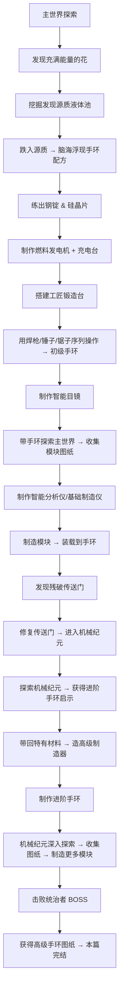

# 🔧 Mechanized 机械纪元 — 总体规划文档

> **模组 ID**: `mechanized` | **版本**: `0.1.0` | **平台**: NeoForge 1.21.1  
> **最后更新**: 2026-10-11

---

## 📋 目录

1. [当前项目状态](#1-当前项目状态)
2. [整体游戏进程设计](#2-整体游戏进程设计)
3. [系统一：基础材料（钢 & 硅）](#3-系统一基础材料钢--硅)
4. [系统二：能量系统（FE & 源质能量）](#4-系统二能量系统fe--源质能量)
5. [系统三：工匠锻造台 & 序列配方](#5-系统三工匠锻造台--序列配方)
6. [系统四：空间穹顶（手环）分级框架](#6-系统四空间穹顶手环分级框架)
7. [系统五：模块系统](#7-系统五模块系统)
8. [系统六：工具与防护装备](#8-系统六工具与防护装备)
9. [系统七：机器方块与 GUI 框架](#9-系统七机器方块与-gui-框架)
10. [系统八：自定义液体（源质）](#10-系统八自定义液体源质)
11. [系统九：自定义维度（机械纪元）](#11-系统九自定义维度机械纪元)
12. [开发阶段与优先级](#12-开发阶段与优先级)
13. [包结构规划](#13-包结构规划)
14. [待讨论 & 待决事项](#14-待讨论--待决事项)
15. [选做 / 后期优化清单](#15-选做--后期优化清单)

---

## 1. 当前项目状态

### 已实现的内容

| 类型 | 内容 | 状态 |
|------|------|------|
| 物品 | `basic_dome`（初级手环）— GeckoLib 动画物品，Curios 手环槽位 | ✅ 已完成 |
| 物品 | `booster`（推进器）— 装备到靴子槽，加速+跳跃 | ✅ 已完成 |
| 方块 | `energetic_flower`（充满能量的花）— FlowerBlock | ✅ 已注册（无世界生成） |
| 方块 | `dome_tuner`（手环调整器）— 带方块实体，有自定义模型 | ✅ 已注册（功能未完成） |
| 系统 | Curios 集成 — bracelet 槽位、渲染器 | ✅ 已完成 |
| 系统 | GeckoLib 集成 — 手环模型、动画、UV 滚动特效 | ✅ 已完成 |
| 资源 | 中英文本地化、方块状态、模型、贴图 | ✅ 已完成 |

### 尚未实现

- ❌ 配方系统（无任何配方 JSON）
- ❌ 战利品表
- ❌ 能量系统（FE / 源质能量）
- ❌ 自定义实体/生物
- ❌ 自定义液体
- ❌ 自定义维度
- ❌ 世界生成（花和源质的自然生成）
- ❌ GUI/菜单系统
- ❌ 网络数据包
- ❌ 音效

---

## 2. 整体游戏进程设计



### 手环等级进程

| 等级 | 英文 ID | 获取方式 | 制作地点 | 能量类型 |
|------|---------|----------|----------|----------|
| 初级 | `basic` | 跌入源质获得灵感 | 工匠锻造台（手搓） | 电能（FE） |
| 中级 | `advanced` | 机械纪元某物启示 | 高级制造器（主世界） | 源质能量 |
| 高级 | `the_greatest` | 击败统治者 BOSS 获得图纸 | 高级制造器（主世界） | 源质能量 / 更高级能源 |
| 创造 | `creative` | 仅创造模式 | — | 无限 |

> [!NOTE]
> **世界观设定**：初级手环是玩家仿照终极手环自制的，结合了主世界科技（电能）和机械纪元科技的仿制品。
> 中级及以上手环才是机械纪元原始正统科技，使用源质能量。
> 因此需要一个「源质转电能转换器」机器，将源质液体转化为 FE 电能供初级手环使用。

---

## 3. 系统一：基础材料（钢 & 硅）

### 设计方案（已确定 ✅）

#### 钢锭（Steel Ingot）
```
工作台合成：铁锭 + 煤炭 → 粗钢坯（Raw Steel Blend）
高炉冶炼：粗钢坯 → 钢锭（Steel Ingot）
```

- **理由**：铁+碳=钢是常识直觉，高炉暗示高温渗碳，两步操作不繁琐但有仪式感
- **额外衍生**：钢锭 → 钢板（Steel Plate）、钢棒（Steel Rod）等

#### 硅晶片（Silicon Wafer）
```
高炉冶炼：下界石英 → 硅晶片（Silicon Wafer）
```

- **理由**：SiO₂ → Si 的简化，利用已有的下界探索进程

### 需要注册的物品

| 物品 | 英文 ID | 说明 |
|------|---------|------|
| 粗钢坯 | `raw_steel_blend` | 中间产物，工作台合成 |
| 钢锭 | `steel_ingot` | 核心材料 |
| 钢板 | `steel_plate` | 锻造台/工作台产物 |
| 钢棒 | `steel_rod` | 锻造台/工作台产物 |
| 硅晶片 | `silicon_wafer` | 核心材料 |

### 技术实现

- 粗钢坯：标准 `ShapelessRecipe` JSON（铁锭 + 煤炭）
- 钢锭：标准 `BlastingRecipe` JSON（粗钢坯，经验值 0.7，冶炼时间 200 tick）
- 硅晶片：标准 `BlastingRecipe` JSON（下界石英）

> [!NOTE]
> ⏳ 钢板和钢棒的合成方式**待定**——等手环的锻造配方确定后再决定。
> 可选项：工作台合成 / 锻造台锤打切割 / 两者都支持。

---

## 4. 系统二：能量系统（FE & 源质能量）

### 设计方案（已确定 ✅）

采用 **NeoForge 内置的 `IEnergyStorage` / Forge Energy（FE）** 作为基础能量标准，
天然兼容所有使用 FE 的科技模组（Mekanism、Thermal、Pipez 等）。

### 双层能量体系

| 能量类型 | 适用对象 | 来源 | 说明 |
|----------|----------|------|------|
| **电能（FE）** | 初级手环、早期工具（焊枪等）、早期机器 | 燃料发电机、风能/太阳能、其他科技模组 | 主世界科技标准 |
| **源质能量** | 中级/高级手环、后期机器 | 源质液体直接灌注 | 机械纪元正统科技 |

### 早期发电设备

| 设备 | 英文 ID | 合成方式 | 功能 |
|------|---------|----------|------|
| 燃料发电机 | `fuel_generator` | 工作台合成（钢锭+熔炉+红石） | 烧煤/木炭产 FE，最基础发电 |
| 充电台 | `charging_station` | 工作台合成（钢锭+红石+铜锭） | 为工具/初级手环充电 |

后期可扩展（Phase 2+）：
- 风力发电机（`wind_generator`）
- 太阳能发电板（`solar_panel`）
- 源质转电能转换器（`source_converter`）— 源质液体 → FE

### 焊枪供能（已确定 ✅）

- 焊枪为**充电式电动工具**，内部存储 FE 能量
- 放入充电台或燃料发电机的输出槽充电
- 如果玩家有其他科技模组，可以直接用那些模组的充能设备
- 焊枪每次焊接操作消耗一定 FE

### 技术实现

```java
// 工具内部储能 — 通过 DataComponents 存储
public record StoredEnergy(int energy, int maxEnergy) { ... }

// 充电台方块实体 — 实现 IEnergyStorage，接收外部电力
// 内部有 ItemStackHandler，检测放入的物品是否有 StoredEnergy 组件
// 每 tick 从自身缓冲区向物品转移能量

// 燃料发电机方块实体 — 烧燃料产生 FE，存入内部缓冲
// 可通过管道/线缆向外输出（兼容其他模组）
```

> [!IMPORTANT]
> 使用 NeoForge 的 `IEnergyStorage` Capability 注册，确保跨模组兼容。
> 物品内部储能使用 `DataComponents`，方块实体储能使用 Capability 暴露。

---

## 5. 系统三：工匠锻造台 & 序列配方

### 核心概念

类似 Create 模组的「序列装配（Sequenced Assembly）」，但完全**手动**操作。
**纯世界交互**（无 GUI），物品像营火一样渲染在锻造台表面。

### 交互方式（已确定 ✅）

| 操作 | 英文 | 玩家行为 | 详细交互 |
|------|------|----------|----------|
| 放置材料 | `place` | 手持材料右键锻造台 | 消耗材料，物品渲染在台面上 |
| 锤打 | `hammer` | 手持锤子右键锻造台 | **每次右键一下，有 0.5 秒冷却**，可配置次数（`hits`） |
| 焊接 | `weld` | 手持焊枪右键锻造台 | **长按右键持续焊接，松开暂停可继续**，需持续时间（`duration_ticks`），副手需面具/目镜 |
| 切割 | `saw` | 手持锯子右键锻造台 | 单次右键操作 |

### 焊接操作详细流程

```
1. 副手拿焊接面具（或戴智能目镜）
2. 主手放置所需材料到锻造台
3. 主手切换为焊枪
4. 右键长按锻造台 → 开始焊接
5. 松开暂停，再次长按继续
6. 累计达到所需时长后完成该步骤
```

焊接保护检查：
- ✅ 副手有焊接面具 **或** Curios goggles 槽有智能目镜 → 安全
- ❌ 都没有 → 火花溅射伤害（2.0 dmg）+ 失明效果（5 秒）

### 视觉反馈（已确定 ✅）

**粒子特效 + 音效**：
- 🔨 锤打：冒火星粒子 + 叮叮金属撞击声
- 🔥 焊接：喷火花粒子 + 滋滋电弧声
- 🪚 切割：飞碎屑粒子 + 嗡嗡切割声

### 物品渲染

类似营火（Campfire）的渲染方式：
- 方块实体内存储当前台面上的物品
- 客户端通过 `BlockEntityRenderer` 将物品渲染在台面上方
- 物品使用 `ItemDisplayContext.FIXED` 或 `GROUND` 上下文渲染

### 配方 JSON 格式设计

```json
{
  "type": "mechanized:forging",
  "steps": [
    {
      "action": "place",
      "ingredient": { "item": "mechanized:steel_plate" }
    },
    {
      "action": "hammer",
      "tool": { "item": "mechanized:hammer" },
      "hits": 3
    },
    {
      "action": "place",
      "ingredient": { "item": "mechanized:silicon_wafer" }
    },
    {
      "action": "weld",
      "tool": { "item": "mechanized:welding_torch" },
      "duration_ticks": 60
    },
    {
      "action": "place",
      "ingredient": { "item": "minecraft:redstone" }
    },
    {
      "action": "saw",
      "tool": { "item": "mechanized:saw" }
    }
  ],
  "result": {
    "item": "mechanized:basic_dome",
    "count": 1
  },
  "scrap": {
    "item": "mechanized:metal_scrap"
  }
}
```

### 技术实现要点

#### 自定义 RecipeType & Serializer
```
ForgeRecipe implements Recipe<ForgingTableInput>
ForgeRecipeSerializer implements RecipeSerializer<ForgeRecipe>
ForgeRecipeType — 注册到 BuiltInRegistries.RECIPE_TYPE
```

#### ForgingTableBlockEntity 核心状态
```java
public class ForgingTableBlockEntity extends BlockEntity {
    // 当前正在进行的配方（如果匹配到）
    private ResourceLocation currentRecipeId;
    // 当前步骤索引
    private int currentStepIndex = 0;
    // 已放置的所有材料记录（用于生成废品时回收）
    private List<ItemStack> placedMaterials = new ArrayList<>();
    // 当前焊接进度（仅焊接操作使用）
    private int weldProgress = 0;
    // 当前锤打次数（仅锤打操作使用）
    private int hammerCount = 0;
    // 锤打冷却计时器
    private int hammerCooldown = 0; // 10 ticks = 0.5 秒
}
```

#### 配方匹配逻辑
1. 玩家放第一个材料时 → 扫描所有 `ForgeRecipe`，找到第一步匹配的配方列表
2. 每执行一步 → 检查是否与当前配方的下一步匹配
3. 如果不匹配 → 产出废品（`scrap` 字段指定），废品记录已投入的材料信息
4. 如果全部步骤完成 → 产出成品

#### 错误处理 & 废品系统
- 废品物品通过 DataComponents 记录包含的原料类型和数量
- 回收炉（Recycling Furnace）：读取废品数据 → **按可配置比例**返还原料
- 回收率通过**配置接口**控制，不硬编码具体数值

```java
// 回收率配置接口设计
public class RecyclingConfig {
    // 默认回收率，可通过配置文件或数据包调整
    private float defaultRecoveryRate = 0.75f;

    // 也可以按材料类型设置不同回收率
    private Map<ResourceLocation, Float> materialRecoveryRates = new HashMap<>();

    public float getRecoveryRate(ItemStack material) {
        ResourceLocation id = BuiltInRegistries.ITEM.getKey(material.getItem());
        return materialRecoveryRates.getOrDefault(id, defaultRecoveryRate);
    }
}
```

> [!IMPORTANT]
> **配方匹配的关键问题**：当第一个材料放入时，可能匹配多个配方。
> 建议策略：维护一个"候选配方集合"，随着步骤推进逐步缩小范围，直到唯一确定或出错。

---

## 6. 系统四：空间穹顶（手环）分级框架

### 当前问题

现有的 `BasicDomeItem` 是一个独立的具体类，所有逻辑硬编码。需要重构为可参数化的通用框架。

### 重构方案

#### 等级枚举
```java
public enum DomeTier {
    BASIC("basic", 3, 1000, EnergyType.FE, false),
    ADVANCED("advanced", 5, 5000, EnergyType.SOURCE, false),
    THE_GREATEST("the_greatest", 9, 20000, EnergyType.SOURCE, false),
    CREATIVE("creative", Integer.MAX_VALUE, -1, EnergyType.NONE, true);

    private final String id;
    private final int moduleSlots;     // 模块槽位数
    private final int maxEnergy;       // 最大能量（-1 = 无限）
    private final EnergyType energyType; // 接受的能量类型
    private final boolean isCreative;  // 是否创造模式专属

    // constructor, getters...
    // 💡 这些数值可以随时在枚举中调整
}

public enum EnergyType {
    FE,       // Forge Energy 电能（初级手环）
    SOURCE,   // 源质能量（中级/高级手环）
    NONE      // 无需能量（创造手环）
}
```

#### 通用手环物品类
```java
public class SpaceDomeItem extends Item implements GeoItem {
    private final DomeTier tier;

    public SpaceDomeItem(DomeTier tier) {
        super(new Item.Properties().stacksTo(1));
        this.tier = tier;
    }

    // 所有原来 BasicDomeItem 的逻辑迁移到这里
    // 根据 this.tier 的参数来决定行为差异
}
```

#### 注册方式
```java
// ModItems.java
public static final DeferredItem<SpaceDomeItem> BASIC_DOME =
    ITEMS.register("basic_dome", () -> new SpaceDomeItem(DomeTier.BASIC));
public static final DeferredItem<SpaceDomeItem> ADVANCED_DOME =
    ITEMS.register("advanced_dome", () -> new SpaceDomeItem(DomeTier.ADVANCED));
public static final DeferredItem<SpaceDomeItem> THE_GREATEST_DOME =
    ITEMS.register("the_greatest_dome", () -> new SpaceDomeItem(DomeTier.THE_GREATEST));
public static final DeferredItem<SpaceDomeItem> CREATIVE_DOME =
    ITEMS.register("creative_dome", () -> new SpaceDomeItem(DomeTier.CREATIVE));
```

### GeckoLib 模型/动画兼容

- 每个等级可以有**独立的 geo 模型和动画文件**（外观不同）
- 也可以共用同一个模型但通过材质（Texture）区分
- `SpaceDomeItem` 内部根据 `tier` 返回不同的模型/动画路径

### Curios 集成

- 4 个等级的手环共享同一个 `bracelet` 槽位
- Curios tag 中添加所有等级的物品
- 渲染器可以做一个通用的 `SpaceDomeCurioRenderer`

### 能量充能方式

| 手环等级 | 能量类型 | 充能方式 |
|----------|----------|----------|
| 初级 | FE 电能 | 放入充电台充电，或其他科技模组的充能设备 |
| 中级 | 源质能量 | 源质液体直接灌注（具体机制待定） |
| 高级 | 源质能量 / 更高级 | 源质灌注或更高级能源（待定） |
| 创造 | 无 | 无限能量，无需充能 |

> [!TIP]
> 创造专属手环：不消耗能量 + 无限模块槽位 + 全模块解锁。
> 方便模组开发测试和内容创作者展示。

---

## 7. 系统五：模块系统

### 核心概念

- **模块图纸**（Blueprint）：通过目镜观察世界/智能分析仪分析获得
- **模块物品**（Module）：通过基础制造仪/高级制造器 + 图纸 + 材料 制作
- **模块装载**：在手环调整器（Dome Tuner）上将模块安装到手环中

### 数据结构设计

#### 模块类型注册
```java
// 模块类型定义
public record ModuleType(
    ResourceLocation id,
    int energyCost,          // 每 tick 消耗的能量
    DomeTier minTier,        // 最低要求的手环等级
    Component description
) {}

// 注册表
public class ModModules {
    public static final DeferredRegister<ModuleType> MODULE_TYPES = ...;

    public static final Supplier<ModuleType> NIGHT_VISION =
        MODULE_TYPES.register("night_vision", () -> new ModuleType(...));
    public static final Supplier<ModuleType> SHIELD =
        MODULE_TYPES.register("shield", () -> new ModuleType(...));
    // ...
}
```

#### 手环内部存储模块数据

使用 NeoForge 1.21.1 的 `DataComponents` 系统存储已安装的模块列表：

```java
// 自定义 DataComponent
public static final DeferredHolder<DataComponentType<?>, DataComponentType<InstalledModules>>
    INSTALLED_MODULES = DATA_COMPONENTS.register("installed_modules", ...);

// InstalledModules 是一个不可变列表的包装
public record InstalledModules(List<ResourceLocation> moduleIds) { ... }
```

#### 模块效果应用

在 `SpaceDomeItem` 中（或通过 Curios Tick 事件），每 tick 检查已安装的模块并应用效果：
- 夜视模块 → 给予夜视效果
- 护盾模块 → 给予伤害吸收
- 速度模块 → 修改移动速度属性
- 等等...

> [!NOTE]
> **关于自定义注册表**：NeoForge 1.21.1 支持自定义注册表（`RegistryBuilder`）。
> 如果模块种类较多且需要数据包扩展，建议注册一个 `mechanized:module_type` 自定义注册表。
> 如果模块种类不多（<20个），用简单的静态注册 Map 也足够。

---

## 8. 系统六：工具与防护装备

### 物品列表

| 物品 | 英文 ID | 类型 | 说明 |
|------|---------|------|------|
| 锤子 | `hammer` | 耐久工具 | 右键锻造台执行"锤打"，每次右键一下，0.5 秒冷却 |
| 焊枪 | `welding_torch` | **充电式电动工具（FE）** | 右键长按锻造台执行"焊接"，松开暂停可继续 |
| 锯子 | `saw` | 耐久工具 | 右键锻造台执行"切割"，单次操作 |
| 焊接面具 | `welding_mask` | **副手持有** | 焊接时副手需持有，否则火花伤害+失明 |
| 智能目镜 | `smart_goggles` | **Curios goggles 槽位** | 替代焊接面具 + 配方 HUD 提示 + 拿焊枪时展开为全面罩动画 |

### 焊枪技术规格

```java
// 焊枪物品 — 充电式电动工具
public class WeldingTorchItem extends Item {
    private static final int MAX_ENERGY = 10000;  // FE 容量
    private static final int ENERGY_PER_TICK = 5;  // 每 tick 焊接消耗

    // 使用 DataComponents 存储内部电量
    // 支持放入充电台充电
    // 兼容其他科技模组的充能设备（通过 IEnergyStorage Capability）
}
```

### 焊接面具装备方式（已确定 ✅）

**副手持有**（方案 A）：
- 焊接时主手拿焊枪、副手拿面具 — 画面真实有代入感
- 操作流程：副手拿面具 → 主手放材料 → 主手换焊枪 → 长按右键焊接

### 智能目镜（已确定 ✅）

**Curios 自定义 `goggles` 槽位**（方案 B）：
- 不占用头盔位，专属 Curios 槽位
- 替代焊接面具的防护功能
- HUD 显示锻造进度和下一步提示
- **特殊动画**：主手拿焊枪时，目镜从眼前小屏幕展开为覆盖整个面部的全面罩

### 智能目镜 HUD 系统

- 当玩家面对锻造台时，在屏幕上显示当前配方进度和下一步提示
- 技术实现：`RenderGuiLayerEvent` + 自定义 HUD 渲染
- 显示内容示例：
  ```
  ┌─────────────────────────────┐
  │ 锻造进度: [████░░░░] 4/7    │
  │ 下一步: 放置 红石粉          │
  │ 工具: —                      │
  └─────────────────────────────┘
  ```

### 焊接保护机制

```java
// 焊接操作时检查
if (焊枪焊接中) {
    boolean hasProtection =
        player.getOffhandItem().is(ModItems.WELDING_MASK.get()) ||
        CuriosApi.getEquippedItem(player, "goggles", ModItems.SMART_GOGGLES.get()).isPresent();

    if (!hasProtection) {
        // 1. 施加火花溅射伤害（1 心）
        player.hurt(WELDING_SPARK_DAMAGE, 2.0f);
        // 2. 给予失明效果（5 秒）
        player.addEffect(new MobEffectInstance(MobEffects.BLINDNESS, 100, 0));
    }
}
```

---

## 9. 系统七：机器方块与 GUI 框架

### 需要实现的机器

| 机器 | 英文 ID | 类型 | Phase | 功能 |
|------|---------|------|-------|------|
| 燃料发电机 | `fuel_generator` | 单方块+BE+GUI | **1** | 烧燃料产 FE |
| 充电台 | `charging_station` | 单方块+BE+GUI | **1** | 为工具/手环充电 |
| 工匠锻造台 | `forging_table` | 单方块+BE（无 GUI） | **1** | 序列配方操作台 |
| 手环调整器 | `dome_tuner` | 单方块+BE+GUI | **2** | 手环模块装卸+功能调节 |
| 回收炉 | `recycling_furnace` | 单方块+BE+GUI | **2** | 熔炼废品→按配置比例回收材料 |
| 智能分析仪 | `smart_analyzer` | 单方块+BE+GUI | **2** | 物品 → 模块图纸 |
| 基础制造仪 | `basic_fabricator` | 单方块+BE+GUI | **2** | 图纸 + 材料 → 模块 |
| 源质转换器 | `source_converter` | 单方块+BE+GUI | **2-3** | 源质液体 → FE 电能 |
| 高级制造器 | `advanced_fabricator` | **多方块结构** | **4** | 制造中级/高级手环 |

### GUI 框架（通用）

NeoForge 1.21.1 的标准菜单系统：

```
AbstractContainerMenu（菜单逻辑） ←→ BlockEntity（数据持久化）
        ↕
AbstractContainerScreen（客户端渲染）
```

建议在项目中建立一个通用基础：

```java
// 通用机器方块实体基类
public abstract class MachineBlockEntity extends BlockEntity
    implements MenuProvider, ContainerListener {
    protected final ItemStackHandler inventory;
    protected int progress;
    protected int maxProgress;
    protected int energyStored;
    protected int maxEnergyStored;
    // ...通用逻辑
}

// 通用机器菜单基类
public abstract class MachineMenu extends AbstractContainerMenu {
    protected final BlockEntity blockEntity;
    protected final ContainerData data;
    // ...通用槽位绑定逻辑
}
```

### 多方块结构（高级制造器）

- 使用 NeoForge 的 `StructureTemplate` 或自定义验证逻辑
- 核心方块（Controller Block）右键时验证周围的方块是否组成了正确的结构
- 结构形成后，核心方块的方块实体启动功能

> [!NOTE]
> 多方块结构是后期内容（Phase 4），建议先完成单方块机器的 GUI 框架，
> 再在此基础上扩展多方块逻辑。

---

## 10. 系统八：自定义液体（源质）

### 注册方式（NeoForge 1.21.1）

需要注册的内容：
1. **FlowingFluid**（源质静止态 + 流动态）
2. **LiquidBlock**（源质方块）
3. **BucketItem**（源质桶）
4. **FluidType**（NeoForge 流体类型，定义物理属性和渲染）

```java
public class ModFluids {
    // FluidType 注册（NeoForge 特有）
    public static final DeferredRegister<FluidType> FLUID_TYPES = ...;
    public static final Supplier<FluidType> SOURCE_FLUID_TYPE = FLUID_TYPES.register(
        "source_fluid", () -> new FluidType(FluidType.Properties.create()
            .density(1200)
            .viscosity(1500)
            .lightLevel(8)  // 自发光
        ));

    // Fluid 注册
    public static final DeferredRegister<Fluid> FLUIDS = ...;
    public static final Supplier<FlowingFluid> SOURCE_FLUID = ...;        // 静止
    public static final Supplier<FlowingFluid> FLOWING_SOURCE_FLUID = ...; // 流动

    // 对应的 LiquidBlock 和 BucketItem
}
```

### 世界生成

- 类似石油：在地表「充满能量的花」下方 5-15 格处生成一个源质液体池
- 使用自定义 `Feature` 实现
- 花本身也需要一个 `PlacedFeature` 来自然生成在地表

### 源质的特殊效果

玩家跌入源质时的效果（触发剧情）：
- 给予自定义效果或发送特殊数据包
- 如果玩家没有手环 → 灵感触发（显示消息/解锁配方）
- 可以通过 Advancement 系统来跟踪进度触发

---

## 11. 系统九：自定义维度（机械纪元）

### 注册方式

NeoForge 1.21.1 的维度注册主要通过数据包 JSON：

```
data/mechanized/
├── dimension/
│   └── mechanized_era.json          ← 维度定义
├── dimension_type/
│   └── mechanized_era_type.json     ← 维度类型（光照、天花板高度等）
└── worldgen/
    ├── biome/
    │   ├── mechanical_plains.json   ← 群系
    │   ├── circuit_forest.json
    │   └── ...
    ├── configured_feature/          ← 地物
    ├── placed_feature/              ← 放置规则
    └── noise_settings/
        └── mechanized_era.json      ← 噪声设置（地形形状）
```

### 传送门系统

- 自定义传送门方块 + 传送门框架方块
- 传送逻辑参考原版下界传送门实现
- "残破的传送门" → 世界生成结构（Structure），在主世界随机生成
- 玩家修复 = 补全框架方块 + 某种激活方式（如源质点燃？）

> [!WARNING]
> 自定义维度和世界生成是工作量最大的系统之一。
> 建议在所有核心玩法机制（锻造、手环、模块）稳定之后再开发维度内容。

---

## 12. 开发阶段与优先级

### Phase 1：基础材料 & 能量 & 核心制造 🔴 最高优先

> 目标：玩家能够从零开始——发电→充能工具→锻造→制作出初级手环

- [ ] 注册基础材料物品（粗钢坯、钢锭、钢板、钢棒、硅晶片）
- [ ] 编写原版配方 JSON（工作台合成 + 高炉冶炼）
- [ ] 实现能量系统基础（IEnergyStorage Capability、DataComponents 储能）
- [ ] 实现燃料发电机方块 + GUI
- [ ] 实现充电台方块 + GUI
- [ ] 注册工具物品（锤子、焊枪-充电式、锯子）
- [ ] 注册焊接面具物品（副手持有）
- [ ] 重构 `BasicDomeItem` → 通用 `SpaceDomeItem` + `DomeTier` 枚举
- [ ] 注册 4 个等级的手环物品
- [ ] 实现工匠锻造台方块 + 方块实体 + 物品渲染（营火式）
- [ ] 实现自定义配方类型 `ForgeRecipe` + 序列化器
- [ ] 实现锻造台的交互逻辑（右键放材料/使用工具 + 冷却/持续机制）
- [ ] 实现锻造台视觉反馈（粒子特效 + 音效）
- [ ] 实现废品生成逻辑 + 可配置回收率接口
- [ ] 编写初级手环的锻造配方 JSON

### Phase 2：模块 & 机器 & 目镜系统 🟡 高优先

> 目标：玩家能够制作模块并装载到手环，智能目镜提供 HUD

- [ ] 设计并注册模块类型系统
- [ ] 实现手环调整器（Dome Tuner）GUI — 模块装卸界面
- [ ] 注册智能目镜物品 + Curios goggles 槽位
- [ ] 实现焊接保护机制（面具/目镜检测 → 伤害/失明）
- [ ] 实现智能目镜 HUD 渲染（锻造进度 + 下一步提示）
- [ ] 实现智能目镜动画（拿焊枪时展开为全面罩）
- [ ] 实现回收炉方块 + GUI（可配置回收率）
- [ ] 实现智能分析仪方块 + GUI
- [ ] 实现基础制造仪方块 + GUI
- [ ] 注册和实现若干基础模块（夜视、护盾、速度等）
- [ ] 风力/太阳能发电机（扩展发电选项）

### Phase 3：世界生成 & 液体 🟢 中优先

> 目标：世界中能自然生成充满能量的花和源质池

- [ ] 注册自定义液体（源质）
- [ ] 实现源质的渲染、物理、特殊效果
- [ ] 实现充满能量的花的世界生成
- [ ] 实现源质液池的世界生成（花下方）
- [ ] 实现跌入源质的灵感触发事件
- [ ] 实现进度/成就系统（Advancements）
- [ ] 实现源质转电能转换器

### Phase 4：维度 & 高级内容 🔵 后期

> 目标：完成机械纪元维度及后期游戏内容

- [ ] 设计并实现机械纪元维度（群系、地形、天空）
- [ ] 设计传送门结构和传送逻辑
- [ ] 实现机械生命体实体
- [ ] 实现阶段 BOSS
- [ ] 实现高级制造器（多方块结构）
- [ ] 设计并制作中级、高级手环的锻造配方
- [ ] 维度特有的方块、植被、资源
- [ ] 剧情推进系统

---

## 13. 包结构规划

基于当前包结构，建议扩展为：

```
com.ronicus.mechanized/
├── Mechanized.java                     ← 模组入口
├── ModBlocks.java                      ← 方块注册
├── ModItems.java                       ← 物品注册
├── ModBlockEntities.java               ← 方块实体注册
├── ModItemGroups.java                  ← 创造标签注册
├── ModFluids.java                      ← 【新增】液体注册
├── ModMenuTypes.java                   ← 【新增】菜单类型注册
├── ModRecipeTypes.java                 ← 【新增】配方类型注册
├── ModDataComponents.java              ← 【新增】数据组件注册
├── ModModules.java                     ← 【新增】模块类型注册
│
├── device/                             ← 手持/穿戴设备
│   ├── SpaceDomeItem.java              ← 【重构】通用手环物品
│   ├── DomeTier.java                   ← 【新增】手环等级枚举
│   ├── EnergyType.java                 ← 【新增】能量类型枚举
│   ├── DomeArmorItem.java              ← 已有
│   └── module/                         ← 【新增】模块子系统
│       ├── ModuleType.java
│       ├── InstalledModules.java
│       └── ModuleEffectHandler.java
│
├── tool/                               ← 【新增】工具
│   ├── HammerItem.java
│   ├── WeldingTorchItem.java           ← 充电式电动工具
│   ├── SawItem.java
│   ├── WeldingMaskItem.java            ← 副手持有
│   └── SmartGogglesItem.java           ← Curios goggles 槽位
│
├── energy/                             ← 【新增】能量系统
│   ├── StoredEnergy.java               ← DataComponent 物品内储能
│   ├── MachineEnergyStorage.java       ← 通用机器 IEnergyStorage 实现
│   └── EnergyUtils.java               ← 能量工具方法
│
├── machine/                            ← 机器方块
│   ├── base/                           ← 【新增】通用基类
│   │   ├── MachineBlock.java
│   │   ├── MachineBlockEntity.java
│   │   └── MachineMenu.java
│   ├── generator/                      ← 【新增】发电机
│   │   ├── FuelGeneratorBlock.java
│   │   ├── FuelGeneratorBlockEntity.java
│   │   ├── FuelGeneratorMenu.java
│   │   └── FuelGeneratorScreen.java
│   ├── charging/                       ← 【新增】充电台
│   │   ├── ChargingStationBlock.java
│   │   ├── ChargingStationBlockEntity.java
│   │   ├── ChargingStationMenu.java
│   │   └── ChargingStationScreen.java
│   ├── forging/                        ← 【新增】锻造台（无 GUI）
│   │   ├── ForgingTableBlock.java
│   │   ├── ForgingTableBlockEntity.java
│   │   ├── ForgingTableRenderer.java   ← 物品渲染（营火式）
│   │   ├── ForgeRecipe.java
│   │   ├── ForgeRecipeSerializer.java
│   │   └── RecyclingConfig.java        ← 可配置回收率接口
│   ├── dome_tuner/                     ← 已有，待完善
│   │   ├── DomeTunerBlock.java
│   │   ├── DomeTunerBlockEntity.java
│   │   ├── DomeTunerMenu.java
│   │   └── DomeTunerScreen.java
│   ├── recycling/                      ← 【新增】回收炉
│   ├── analyzer/                       ← 【新增】智能分析仪
│   ├── fabricator/                     ← 【新增】基础制造仪
│   └── advanced_fabricator/            ← 【新增】高级制造器（多方块）
│
├── fluid/                              ← 【新增】液体系统
│   ├── SourceFluid.java
│   └── SourceFluidType.java
│
├── world/                              ← 【新增】世界生成
│   ├── feature/
│   ├── dimension/
│   └── structure/
│
├── entity/                             ← 【新增】实体/生物
│   ├── mechanical/
│   └── boss/
│
├── network/                            ← 【新增】网络数据包
│   └── ...
│
└── client/                             ← 客户端
    ├── ClientModEvents.java            ← 已有
    ├── BraceletConfig.java             ← 已有
    ├── hud/                            ← 【新增】HUD 渲染
    │   └── SmartGogglesHud.java
    ├── screen/                         ← 【新增】GUI 屏幕
    │   ├── FuelGeneratorScreen.java
    │   ├── ChargingStationScreen.java
    │   ├── DomeTunerScreen.java
    │   └── ...
    └── renderer/                       ← 渲染器（重组）
        ├── SpaceDomeCurioRenderer.java
        ├── SpaceDomeItemModel.java
        ├── SpaceDomeItemRenderer.java
        └── ForgingTableRenderer.java
```

---

## 14. 待讨论 & 待决事项

以下问题需要在后续开发中逐步确定：

### 材料与配方
- [ ] 钢板/钢棒是工作台合成还是锻造台产物？（等手环配方确定后再定）
- [ ] 初级手环的完整锻造配方步骤？

### 手环与模块
- [ ] 中级/高级手环的源质充能具体机制？（灌注？浸泡？专用机器？）
- [ ] 初期要实现哪些模块？（建议先做 3-5 个核心模块）
- [ ] 模块是否有"等级要求"（某些模块只能装在中级以上手环）？

### 能量系统
- [ ] 燃料发电机的发电速率和容量？
- [ ] 焊枪的 FE 容量和每次操作消耗量？
- [ ] 充电台的充电速度？
- [ ] 是否需要电线/管道传输电力？还是机器之间直接邻接传输？

### 世界与维度
- [ ] 源质的颜色/材质风格？（建议：发光的半透明蓝紫色液体）
- [ ] 机械纪元维度的整体美术风格？
- [ ] 传送门的激活方式？（建议：用源质桶浇在完整框架上）

### 剧情系统
- [ ] 灵感触发的具体表现形式？（聊天消息 / 书与笔 / 自定义 GUI 叙事）
- [ ] 进度系统是用原版 Advancements 还是自定义系统？

---

## 15. 选做 / 后期优化清单

以下功能不影响核心玩法，可在主线功能完成后作为优化添加：

- [ ] 🔨 锻造台物品随操作步骤变形（锤打后变扁、切割后分裂等）
- [ ] 🎨 智能目镜全面罩展开动画（主手拿焊枪时触发）
- [ ] 🌬️ 风力发电机、太阳能发电板等额外发电设备
- [ ] 🔊 更丰富的音效包（环境音效、机器运转声等）
- [ ] 📖 剧情日记/知识系统（收集故事碎片）
- [ ] 🏗️ 锻造台的更精致的 3D 模型和动画
- [ ] ⚡ 电线/管道系统（如果需要远距离传输能量）
- [ ] 🎮 JEI/EMI 集成（锻造配方的查看页面）

---

> [!TIP]
> 本文档将随开发推进持续更新。每次讨论的决定都会回填到对应章节中。
