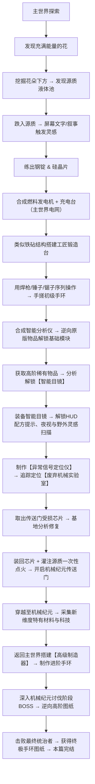

# 🔧 Mechanized 机械纪元 — 总体规划文档

> **模组 ID**: `mechanized` | **版本**: `0.1.0` | **平台**: NeoForge 1.21.1  
> **最后更新**: 2026-10-11

---

## 📋 目录

1. [当前项目状态](#1-当前项目状态)
2. [整体游戏进程设计](#2-整体游戏进程设计)
3. [系统一：基础材料（钢 & 硅）](#3-系统一基础材料钢--硅)
4. [系统二：能量系统（FE & 源质能量）](#4-系统二能量系统fe--源质能量)
5. [系统三：工匠锻造台 & 序列配方](#5-系统三工匠锻造台--序列配方)
6. [系统四：空间穹顶（手环）分级框架](#6-系统四空间穹顶手环分级框架)
7. [系统五：模块系统 & 智能目镜](#7-系统五模块系统--智能目镜)
8. [系统六：机器方块与全周期升级体系](#8-系统六机器方块与全周期升级体系)
9. [系统七：自定义液体（源质）](#9-系统七自定义液体源质)
10. [系统八：传送门、遗迹实验室与机械纪元维度](#10-系统八传送门遗迹实验室与机械纪元维度)
11. [系统九：剧情叙事与引导系统](#11-系统九剧情叙事与引导系统)
12. [开发阶段与优先级](#12-开发阶段与优先级)
13. [包结构规划](#13-包结构规划)
14. [待讨论 & 待决事项](#14-待讨论--待决事项)
15. [选做 / 后期优化清单](#15-选做--后期优化清单)

---

## 1. 当前项目状态

### 已实现的内容

| 类型 | 内容 | 状态 |
|------|------|------|
| 物品 | `basic_dome`（初级手环）— GeckoLib 动画物品，Curios 手环槽位 | ✅ 已完成 |
| 物品 | `booster`（推进器）— 装备到靴子槽，加速+跳跃 | ✅ 已完成 |
| 方块 | `energetic_flower`（充满能量的花）— FlowerBlock | ✅ 已注册（无世界生成） |
| 方块 | `dome_tuner`（手环调整器）— 带方块实体，有自定义模型 | ✅ 已注册（功能未完成） |
| 系统 | Curios 集成 — bracelet 槽位、渲染器 | ✅ 已完成 |
| 系统 | GeckoLib 集成 — 手环模型、动画、UV 滚动特效 | ✅ 已完成 |
| 资源 | 中英文本地化、方块状态、模型、贴图 | ✅ 已完成 |

### 尚未实现

- ❌ 配方系统（无任何配方 JSON）
- ❌ 战利品表
- ❌ 能量系统（FE / 源质能量）
- ❌ 自定义实体/生物
- ❌ 自定义液体
- ❌ 自定义维度
- ❌ 世界生成（花和源质的自然生成、实验室结构）
- ❌ GUI/菜单系统
- ❌ 网络数据包
- ❌ 音效

---

## 2. 整体游戏进程设计



### 手环等级进程

| 等级 | 英文 ID | 获取方式 | 制作地点 | 能量类型 | 槽位数 |
|------|---------|----------|----------|----------|--------|
| 初级 | `basic` | 跌入源质获得灵感 | 工匠锻造台（手搓） | 电能（FE） | 3（可配置） |
| 中级 | `advanced` | 机械纪元某物启示 | 高级制造器（主世界） | 源质能量 | 5（可配置） |
| 高级 | `the_greatest` | 击败统治者 BOSS 获得图纸 | 高级制造器（主世界） | 源质能量 / 高级能量 | 9（可配置） |
| 创造 | `creative` | 仅创造模式 | — | 无限能量 | 无限 |

> [!NOTE]
> **世界观设定**：初级手环是玩家仿照终极手环自制的，结合了主世界科技（电能）和机械纪元科技的仿制品。
> 中级及以上手环才是机械纪元原始正统科技，使用源质能量。
> 因此需要一个「源质转电能转换器」机器，将源质液体转化为 FE 电能供初级手环使用。

---

## 3. 系统一：基础材料（钢 & 硅）

### 设计方案（已确定 ✅）

#### 钢锭（Steel Ingot）
```
工作台合成：铁锭 + 煤炭 → 粗钢坯（Raw Steel Blend）
高炉冶炼：粗钢坯 → 钢锭（Steel Ingot）
```

#### 硅晶片（Silicon Wafer）
```
高炉冶炼：下界石英 → 硅晶片（Silicon Wafer）
```

#### 衍生建材与工匠锻造台合成（已确定 ✅）
* **钢块（Steel Block）**：9 个钢锭合成。
* **钢板（Steel Plate）**：工作台 2 个钢锭横向排列合成。
* **钢棒（Steel Rod）**：工作台 2 个钢锭竖向排列合成。
* **工匠锻造台（Forging Table）**：
  * **借鉴原版铁砧合成摆法**：顶部一排 3 个钢块，中间 1 个钢锭，底部一排 3 个钢锭。极具工业重工质感，贴近原版记忆。

---

## 4. 系统二：能量系统（FE & 源质能量）

### 双层能量体系（已确定 ✅）

| 能量类型 | 适用对象 | 来源 | 说明 |
|----------|----------|------|------|
| **电能（FE）** | 初级手环、早期工具（焊枪等）、早期机器 | 燃料发电机、风能/太阳能、其他科技模组 | 主世界科技标准（兼容第三方模组线缆） |
| **源质能量** | 中级/高级手环、后期机器 | 源质液体直接灌注、源质虹吸模块 | 机械纪元正统科技 |

### 供电与电网机制
1. **前期（主世界）**：
   * **发电机内置充能槽**：可直接将焊枪、初级手环放入随身充能。
   * **邻接自动推电**：发电机紧贴充电台等机器时自动平缓供电，无需拉线。
   * **兼容第三方线缆**：全面暴露 NeoForge `IEnergyStorage` Capability。
2. **后期（机械纪元突破）**：
   * **无线共鸣能量塔（Wireless Power Pylon）**：摆脱传统拉电线模式，区域内无线广播供能。

---

## 5. 系统三：工匠锻造台 & 序列配方

### 核心交互机制（已确定 ✅）
* **无 GUI，纯世界右键交互**：物品如同营火一样立体渲染在锻造台表面。
* **操作方式**：
  * 放置：主手持材料右键台面。
  * 锤打：手持锤子右键，**单次敲打，内置 0.5 秒冷却**（防误触，节奏感强）。
  * 焊接：主手焊枪长按右键，**松开暂停可继续累积进度**。
  * 切割：手持锯子单次右键修边。
* **视觉与音效**：
  * 锤打：金属叮叮声 + 溅射火星；
  * 焊接：电弧滋滋声 + 焊接粒子；
  * 切割：切割飞屑粒子 + 电锯音效。

### 初级手环装配 4 步工序（方式 A 已确定 ✅）
1. `放置` 硅晶片 ➔ `锯子切割`（修整芯片引脚）；
2. `放置` 铜线/红石 ➔ `焊枪焊接` 3秒（焊接控制回路）；
3. `放置` 钢板 ➔ `锤打` 3次（冲压成手镯外壳，与底板契合）；
4. `放置` 玻璃板 ➔ `焊枪焊接` 2秒（密封封装全息屏，产出初级手环成品）。

### 容错与废品回收系统
* 任何一步顺序错误、使用错误工具即判定为报废，生成【金属废品】。
* 废品保存内部原料数据，放入【回收炉】可按配置比例（`RecyclingConfig`）回收原材料。

---

## 6. 系统四：空间穹顶（手环）分级框架

### 通用框架类与枚举（已确定 ✅）
* `SpaceDomeItem` 通用类继承自 `Item` 并实现 GeckoLib `GeoItem` 与 Curios 接口。
* `DomeTier` 枚举定义：
  * `BASIC`：3 槽位，FE 电能，1000 容量
  * `ADVANCED`：5 槽位，源质能量，5000 容量
  * `THE_GREATEST`：9 槽位，源质能量，20000 容量
  * `CREATIVE`：无限槽位，无限能量
* 所有参数统一在枚举数组中对外暴露，方便后续随时平衡调试。

### 源质充能体系（已确定 ✅）
* **基地充能**：手环调整器（Dome Tuner）接入流体储罐，放入手环快速注入源质。
* **野外充能（源质虹吸模块）**：搭载该模块后，玩家佩戴手环浸入源质池，手环会缓慢虹吸能量被动回能。

---

## 7. 系统五：模块系统 & 智能目镜

### 前后端双轨协作闭环（已确定 ✅）
* **智能目镜（前端/外出侦测）**：
  * 装备于 Curios 专属 `goggles` 槽位，不占头盔位。
  * 外出探索时，目镜自动高亮标记世界中具有“潜在灵感”的特殊物体，或生成扫描数据卡。
  * 带有**夜视模式**（右键切换），主手持焊枪时触发展开全面罩动画。
  * 显示锻造台序列装配 HUD，彻底避免操作失误。
* **智能分析仪（后方/基地逆向解码）**：
  * 将采集回来的灵感物品或目镜数据放入分析仪解码，生成【模块图纸】。
  * 早期基础模块逆向表：
    * `铁镐` ➔ **⛏️ 挖掘模块（Mining Module）**
    * `羽毛/烟花` ➔ **🚀 推进模块（Booster Module）**
    * `指南针/铁块` ➔ **🧲 磁吸模块（Magnet Module）**
    * `盾牌/绿宝石` ➔ **🛡️ 动能护盾模块（Kinetic Shield Module）**
  * **科技树质变点**：探索获取高阶稀有物品（如下界之星）➔ 放入分析仪逆向解锁【智能目镜图纸】！

---

## 8. 系统六：机器方块与全周期升级体系

### 机器“永不落伍”设计哲学（已确定 ✅）
* 机器不仅在前期使用，全程伴随玩家成长：
  * **智能分析仪**：中期分析机械纪元外星科技，后期分析 BOSS 战利品传奇图纸；后期部分高阶物体需前置解密后才能送入分析仪。
  * **工匠锻造台**：后期使用机械纪元新金属进行高阶精密锻造。
  * **全系机器模块化升级**：各机器预留升级槽位，支持安装【加速模块】、【能效模块】、【储量扩展模块】等。

---

## 9. 系统七：自定义液体（源质）

### 视觉与物理属性（已确定 ✅）
* **外观颜色**：发光的半透明青蓝色（十六进制：`#06D5F9`，ARGB 约 `0xCC06D5F9`）。
* **光照强度**：轻微自发光（Light Level 8~10）。
* **粒子效果**：复用原版微光/传送门粒子进行青蓝色改色，和谐融入原版画风。
* **特殊机制**：玩家跌入未加工源质液体时触发剧情叙事字幕与灵感涌现。

---

## 10. 系统八：传送门、遗迹实验室与机械纪元维度

### 废弃机械实验室与激活流程（已确定 ✅）
* **生成结构**：主世界自然生成稀有地下/地表遗迹【废弃机械实验室（Abandoned Lab）】。
* **寻找机制（告别原版眼盲痛点）**：
  * 制作**【异常信号定位仪（Signal Locator）】**。
  * 不会像末影之眼那样消耗碎裂，手持或右键提供明确的信号指示（音调频率或 HUD 方位引导），指引玩家直奔实验室。
* **修复与启动**：
  1. 取下控制台损坏的芯片 ➔ 带回基地用分析仪修复；
  2. 将修复芯片插回传送门控制台；
  3. 注入适量源质液体完成“一次性点火”；
  4. 传送门常态开启，永久免维护运行！

---

## 11. 系统九：剧情叙事与引导系统

### 沉浸式环境叙事（已确定 ✅）
* **关键剧情节点**（如跌入源质、激活传送门）：采用**屏幕大标题文字（Title）+ 聊天栏日志 + 专属环境音效**呈现。
* **主线引导机制**：采用**原版 Advancements（成就进度树）**，直观清晰指引玩家下一阶段目标。
* **说明书生态**：后续可选接入 Patchouli 模组作为拓展手册，不作为强制前置。

---

## 12. 开发阶段与优先级

### Phase 1：基础材料 & 能量 & 核心制造 🔴 最高优先

> 目标：玩家能够从零开始——炼钢炼硅 → 发电充电 → 锻造台操作 → 手搓出初级手环

- [ ] 注册基础材料物品（粗钢坯、钢锭、钢块、钢板、钢棒、硅晶片）
- [ ] 编写原版配方 JSON（粗钢坯合成、高炉炼钢、高炉炼硅、钢块/板/棒合成）
- [ ] 编写工匠锻造台合成配方（铁砧式摆法）
- [ ] 实现能量系统基础（NeoForge IEnergyStorage Capability、DataComponents 物品储能）
- [ ] 实现燃料发电机方块 + BE + 内置充能槽与邻接推电 + GUI
- [ ] 实现充电台方块 + BE + GUI
- [ ] 注册工具物品（锤子-带冷却、焊枪-电动长按、锯子）
- [ ] 注册焊接面具物品（副手持有）
- [ ] 重构 `BasicDomeItem` → 通用 `SpaceDomeItem` + `DomeTier` 枚举（3/5/9/无限）
- [ ] 注册 4 个等级的手环物品
- [ ] 实现工匠锻造台方块 + 方块实体 + 营火式立体物品渲染
- [ ] 实现自定义配方类型 `ForgeRecipe` + 序列化器（4步工序）
- [ ] 实现锻造台交互逻辑、粒子与音效反馈
- [ ] 实现金属废品与可配置回收率接口 `RecyclingConfig`
- [ ] 编写初级手环完整的锻造配方 JSON

### Phase 2：模块 & 机器 & 目镜系统 🟡 高优先

> 目标：智能分析仪逆向图纸、手环调整器装载、智能目镜解锁与 HUD

- [ ] 实现智能分析仪方块 + BE + GUI（原版物品逆向解码）
- [ ] 实现手环调整器（Dome Tuner）GUI — 模块装卸与流体储罐
- [ ] 实现第一批核心模块：⛏️挖掘、🚀推进、🧲磁吸、🛡️护盾、💧源质虹吸
- [ ] 注册智能目镜物品 + Curios `goggles` 槽位
- [ ] 实现焊接保护判定（面具/目镜防失明伤害）
- [ ] 实现智能目镜 HUD（锻造引导、野外灵感扫描高亮、夜视切换）
- [ ] 实现回收炉方块 + GUI

### Phase 3：世界生成 & 液体 & 实验室探索 🟢 中优先

> 目标：源质自然生成、异常信号定位仪、实验室传送门激活

- [ ] 注册青蓝色源质液体（#06D5F9）+ 流体方块 + 桶 + 改色粒子
- [ ] 实现地表“充满能量的花”与地下“源质池”世界生成
- [ ] 实现跌入源质时的屏幕文字叙事与灵感 Advancements
- [ ] 实现废弃机械实验室（Abandoned Lab）结构生成
- [ ] 实现异常信号定位仪（Signal Locator）及寻路逻辑
- [ ] 实现传送门修复芯片与点火开启逻辑

### Phase 4：维度 & 机械纪元生态 🔵 后期

> 目标：进入新维度，多方块高级制造器，无线电网，BOSS战

- [ ] 设计并实现机械纪元维度（群系、地表、噪声地形）
- [ ] 机械纪元专属生物、植被与矿物
- [ ] 实现高级制造器（多方块结构）
- [ ] 制作中级与终极手环
- [ ] 实现无线共鸣能量塔
- [ ] 机械纪元阶段 BOSS 与统治者挑战

---

## 13. 包结构规划

```
com.ronicus.mechanized/
├── Mechanized.java                     ← 模组入口
├── ModBlocks.java                      ← 方块注册
├── ModItems.java                       ← 物品注册
├── ModBlockEntities.java               ← 方块实体注册
├── ModItemGroups.java                  ← 创造标签注册
├── ModFluids.java                      ← 液体注册
├── ModMenuTypes.java                   ← 菜单类型注册
├── ModRecipeTypes.java                 ← 配方类型注册
├── ModDataComponents.java              ← 数据组件注册
├── ModModules.java                     ← 模块类型注册
│
├── device/                             ← 手持/穿戴设备
│   ├── SpaceDomeItem.java              ← 【重构】通用手环物品
│   ├── DomeTier.java                   ← 手环等级枚举
│   ├── EnergyType.java                 ← 能量类型枚举
│   ├── DomeArmorItem.java              ← 已有
│   └── module/                         ← 模块子系统
│       ├── ModuleType.java
│       ├── InstalledModules.java
│       └── ModuleEffectHandler.java
│
├── tool/                               ← 工具与防护
│   ├── HammerItem.java                 ← 锤子
│   ├── WeldingTorchItem.java           ← 充电式焊枪
│   ├── SawItem.java                    ← 锯子
│   ├── WeldingMaskItem.java            ← 焊接面具（副手）
│   ├── SmartGogglesItem.java           ← 智能目镜（Curios）
│   └── SignalLocatorItem.java          ← 异常信号定位仪
│
├── energy/                             ← 能量系统
│   ├── StoredEnergy.java               ← DataComponent 物品储能
│   ├── MachineEnergyStorage.java       ← 机器 FE 实现（推电/充电）
│   └── EnergyUtils.java
│
├── machine/                            ← 机器方块
│   ├── base/                           ← 通用机器基类
│   │   ├── MachineBlock.java
│   │   ├── MachineBlockEntity.java
│   │   └── MachineMenu.java
│   ├── generator/                      ← 燃料发电机
│   ├── charging/                       ← 充电台
│   ├── forging/                        ← 工匠锻造台（无 GUI）
│   ├── dome_tuner/                     ← 手环调整器
│   ├── recycling/                      ← 回收炉
│   ├── analyzer/                       ← 智能分析仪
│   └── fabricator/                     ← 制造仪
│
├── fluid/                              ← 液体系统
│   ├── SourceFluid.java
│   └── SourceFluidType.java
│
├── world/                              ← 世界生成
│   ├── feature/
│   ├── dimension/
│   └── structure/                      ← 实验室结构
│
├── entity/                             ← 实体/生物
│
└── client/                             ← 客户端渲染与 HUD
    ├── ClientModEvents.java
    ├── hud/
    │   ├── SmartGogglesHud.java
    │   └── SignalLocatorHud.java
    └── renderer/
        ├── SpaceDomeCurioRenderer.java
        ├── ForgingTableRenderer.java
        └── ...
```

---

## 14. 选做 / 后期优化清单

- [ ] 🔨 锻造台物品随操作步骤变形（锤打后变扁、切割后分裂等）
- [ ] 🎨 智能目镜全面罩展开动画（主手拿焊枪时触发）
- [ ] 🌬️ 风力发电机、太阳能发电板等额外发电设备
- [ ] 🔊 专属音效设计包（机器运行、电流共鸣等）
- [ ] 📖 Patchouli 官方指导手册联动支持
- [ ] 🎮 JEI / REI / EMI 锻造配方查看页面支持
